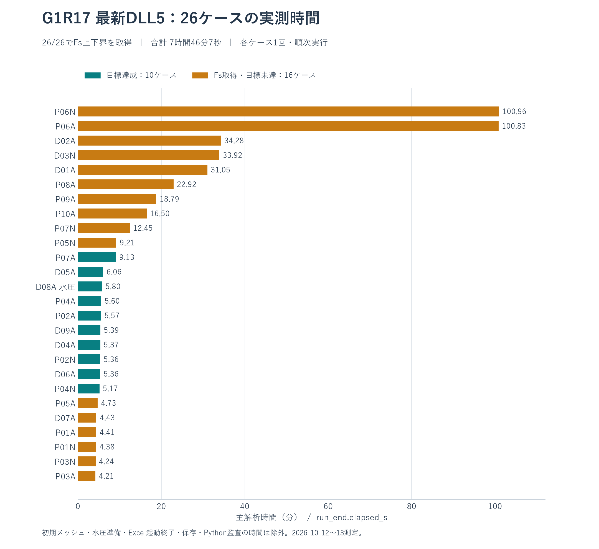

# excel-vba-rpfem

Excel VBAによる2次元RPFEM解析のソース、XLSM、検証資料です。

**最新の改善版は [G1R18 Release](https://github.com/tak063495-prog/excel-vba-rpfem/releases/tag/G1R18) です。** [バージョン一覧](versions/README.md)から過去版も確認できます。

## G1R18 Issue #12 修正版（2026-10-14）

- **[配布一式ZIP](downloads/RPFEM_G1R18_Issue12_20261014.zip)** / [修正内容と検証](versions/G1R18_Issue12/README.md) / [SHA-256](downloads/SHA256SUMS.txt)
- `LOWER_MODEL_CACHE=1` で、粗探索q4の原プログラム情報が最終q8に残り、精度回復・固定荷重回復の負側下界が `HSD_NOT_CONVERGED` で拒否される不具合を修正しました。qが異なるキャッシュは無効化してq8で再構築します。q8監査ゲートは維持しています。
- 実Excelで、修正版のキャッシュ有効時の結果がキャッシュ無効時と全桁一致し、既定設定（標準斜面・D07A）はG1R18と全桁一致しました。DLLはG1R18と同一です。

## G1R18 — 最新の改善版（2026-10-14）

- **[配布一式ZIP](https://github.com/tak063495-prog/excel-vba-rpfem/releases/download/G1R18/RPFEM_20261014_G1R18.zip)** / [XLSM](versions/G1R18/delivery/RPFEM_20261014_G1R18.xlsm) / [SHA-256](versions/G1R18/SHA256SUMS.txt)
- [導入・設定・検証範囲](versions/G1R18/README_JA.md) / [VBAソース](versions/G1R18/src/vba) / [新DLLのソース・ビルド・数値検証](versions/G1R18/native/accuracy/README.md)
- [今回の精度再監査](validation/accuracy_20261013/snapshots/20261014_progress7_audit/REPORT_JA.md) / [P06の継続課題 #11](https://github.com/tak063495-prog/excel-vba-rpfem/issues/11)

適合細分化、別々の上下界場の保存、原q8監査と根の確認をVBAへ統合しました。
追加DLLは、元の物理目的へ上限・下限を付けた二次目的による場の回復、
平衡残差のLSMR補正、原双対制約の回復を実行します。補助目的の双対を根の証拠には使いません。
精度回復は設定 `ACCURACY_DLL_RECOVERY=1` で有効にでき、既定値は0です。
XLSMと同じフォルダーに、既存の `rpfem_native_x64.dll` と追加の
`rpfem_accuracy_x64.dll` を置きます。実行時にPythonは必要ありません。

Pythonの独立再監査では、旧表で精度目標未達だった16ケース中14ケースで、q8・両側の根区間・対称幅1%以下を確認しました。
P06も旧G1R17の実Excel保存場から上下界幅を縮小しました。

|ケース|G1R17 実Excel・旧保存場の幅|Python実験・最新保存場の幅|1%目標|
|---|---:|---:|---|
|P06A|8.612876%|1.261478%|未達・継続課題|
|P06N|12.038014%|1.364711%|未達・継続課題|

幅は `2*(上界-下界)/(上界+下界)`。[旧G1R17実測](docs/benchmarks/G1R17_native26_20261013/data/RESULTS.csv)と[最新保存場の再監査](validation/accuracy_20261013/snapshots/20261014_progress7_audit/REPORT_JA.md)を比較しています。
最新値はPython実験の保存場を元のq8式で再監査した結果です。
VBA/DLLの小規模数値回帰、Fs根探索、失敗時の場の保持、配布ブックの再読込みは合格しました。
G1R18での本番規模のP06再現と1%達成は[Issue #11](https://github.com/tak063495-prog/excel-vba-rpfem/issues/11)で継続します。G1R18の速度比較は今回実施していません。

Issue #8の水理修正も取り込み済みです。[水理修正の検証](versions/G1R17_Issue8/README.md)。

剛塑性有限要素法による**極限解析の下界・上界**を求め、強度低減安全率Fsまたは極限荷重倍率を出力します。変位・沈下量を求める弾塑性解析ではありません。非関連流れ則の入力ではDavis等価関連モデルを使うため、結果の解析政策も確認してください。

## 使い方・原理・注意事項

|資料|内容|
|---|---|
|[使い方](docs/USAGE_JA.md)|動作環境、ダウンロード、P06Nの実行、各入力表・設定・出力の読み方、支持力モード、ログの保存|
|[解析の原理](docs/PRINCIPLES_JA.md)|剛塑性と上下界、2次三角形要素、Mohr–Coulomb条件、強度低減・Davis変換、SOCP・内点法・HSD、適応メッシュとコードの対応|
|[注意事項・不具合時の確認](docs/NOTES_JA.md)|検証の範囲、GAPと根幅、解析領域・多層・剛体界面、c=0/小さいc、数値失敗、速度図・応力係数、マクロ・復元|

### 最初の実行

1. G1R18の配布ZIPを展開し、XLSMと2個のDLLを同じローカルフォルダーに置きます。配布ブックは標準斜面・未解析の状態なので、対象モデルの入力を確認します。
2. 入手元・ハッシュを確認し、組織の規則に従ってそのファイルのマクロを実行できる状態にします。通常の解析にPythonやVBAプロジェクトアクセスの許可は不要です。
3. 「実行案内」「材料データ」「設定」を確認し、「要素定義」の**「要素作成②」→「図を表示」→「解析」**を使います。「解析」は入力からメッシュを再生成するため、要素作成は形状の事前確認用です。
4. 「解析結果」の下界・上界・区間幅・解析政策と、ログ末尾の判定を確認します。`PARTIAL_CERTIFIED`は目標未達を含みます。詳しい操作は[使い方](docs/USAGE_JA.md)を参照してください。

追加の精度回復は「設定」の「精度重視の設定」ボタンで有効にできます。材料・解析政策・領域・荷重の入力を保持します。設定と検証範囲は[G1R18の導入手順](versions/G1R18/README_JA.md)を確認してください。

**G1R15では、G1R14（定常浸透・間隙水圧の一方向連成）に、浸透入力シートの整理・地下水面からの水圧入力・水平震度法（地震）を追加した（実Excelで全回帰済み：連成OFF・kh=0でD03N・D07AのFsがG1R14と全桁一致）。G1R14では連成OFFでD03N・D07AのFsがG1R13と全桁一致した。G1R13の修復・制限は[G1R13報告](versions/G1R13/REPORT.md)、G1R12時点の25ケース結果（23/25取得・11/25目標達成）は[過去25ケース結果](validation/G1R12_native25_20261009/REPORT.md)を参照し、区別する。図の矢印は規準化された速度機構であり、変位量ではない。**

## G1R17・DLL5 — 前版の26ケース実測結果

2026年10月12日〜13日に、同じG1R17コードで26ケースのFs探索・適応解析を実Excelで実行しました。**独立物理監査済みFs上下界は26/26ケースで取得、精度目標達成は10/26ケース**です。主解析時間の合計は **7時間46分7秒**。最長のP06Nは1時間40分57秒、P06Aは1時間40分50秒でした。

- **[全26ケースの結果表・Fs上下界図・GAP図・速度比較・計測条件](docs/benchmarks/G1R17_native26_20261013/README.md)**
- [結果CSV](docs/benchmarks/G1R17_native26_20261013/data/RESULTS.csv) / [処理区間別CSV](docs/benchmarks/G1R17_native26_20261013/data/PHASE_TIMINGS.csv) / [採用精度と最終確認の記録](docs/benchmarks/G1R17_native26_20261013/QUALITY_NOTES.md)
- **[結果XLSM26冊・DLL・入力・原ログ・保存場・独立監査の証拠ZIP（約83 MiB）](https://github.com/tak063495-prog/excel-vba-rpfem/raw/refs/heads/main/downloads/RPFEM_G1R17_Native26_20261012.zip)**

P06A・P06Nはq8上下界を取得しましたが、GAPは8.613%・12.038%で目標未達です。P08A・P09A・P10Aはq8の最終HSD確認が時間予算に達し、監査済みq4上下界を保持しました。Fs取得と目標精度の達成を区別しています。D08Aは指定静水圧場の連成解析、NケースはDavis等価関連モデルです。

条件を照合できた過去DLL2の10ケースでは、主時間合計比 **2.823倍**、保存上下界場は全ケースで両方ともビット一致しました。同一PCの各1回の測定による版全体の参考比です。DLLなしの26ケース全解析は再計測していません。

## G1R17 — 前版のP06A・P06N粗メッシュ修復、VBA／DLL対応

2026年10月12日。c=0自由頂点からゼロ応力が伝わる鈍角要素の局所制約を、PythonのSOCP・LP双対と実Excelで特定し、VBAとDLL5の両方で修復しました。粗メッシュは243→245要素、追加節点は1つです。構成則・Davis変換・Fs定義・物理監査・求解許容差は維持しています。

- **[XLSM2冊・対応DLL・ソース・Python検証の一式ZIP](https://github.com/tak063495-prog/excel-vba-rpfem/raw/refs/heads/main/downloads/RPFEM_G1R17_20261012.zip)**
- [P06N設定済みXLSM](https://github.com/tak063495-prog/excel-vba-rpfem/raw/refs/heads/main/versions/G1R17/delivery/RPFEM_20261012_G1R17_P06N_Coarse_Checked.xlsm) / [P06A設定済みXLSM](https://github.com/tak063495-prog/excel-vba-rpfem/raw/refs/heads/main/versions/G1R17/delivery/RPFEM_20261012_G1R17_P06A_Coarse_Checked.xlsm) / [G1R17対応DLL](https://github.com/tak063495-prog/excel-vba-rpfem/raw/refs/heads/main/versions/G1R17/delivery/rpfem_native_x64.dll)
- [原因・実装・検証報告](versions/G1R17/REPORT.md) / [使い方](versions/G1R17/README.md) / [導入・復旧](versions/G1R17/IMPORT_ROLLBACK_JA.md) / [試験台帳](versions/G1R17/TEST_RESULTS.csv) / [局所メッシュ比較図](versions/G1R17/figures/P06N_local_mesh.png)

|ケース|Fs下界|Fs上界|判定|
|---|---:|---:|---|
|P06N（Davis等価）|0.56014868|0.88211706|PARTIAL_CERTIFIED|
|P06A（関連）|0.73110643|1.02853738|PARTIAL_CERTIFIED|

この表と配布2冊は10月12日の修復時に使ったTARGET200、q8、適応OFF、浸透OFF、kh0の粗メッシュ確認用です。上界で規準化した幅は36.50%／28.92%で目標精度には未達でした。当時のVBA／DLL固定Fs全応力場は両ケースともビット一致、保存場のPython物理監査はPASS、他23ケースのメッシュは変更されませんでした。当時の25ケース比較はメッシュ生成のみです。その後に実行した26ケースのFs全解析結果は[上記の実測報告](docs/benchmarks/G1R17_native26_20261013/README.md)を参照してください。

ブックとDLLはG1R17の組で、同じフォルダーに置きます。DLL交換前にExcelを終了してください。DLL不在・旧DLLでは修復済みVBAへ復帰します。G1R17はDLL5の改訂で、DLL6は作成していません。

## G1R16 DLL5 — Schur・HSD修復・疎構造・一括演算の追加最適化

2026年10月12日。主要な追加最適化をDLL5にまとめました。堤防例題は **DLL4 272.97秒 → DLL5 142.17秒（47.92%短縮、約1.92倍）**。両版を同一PCで順番に再測定しています。DLLなしの既存実測611.56秒比では約4.30倍ですが、VBAの長時間測定は再実行していません。

- **[対応XLSM・DLL・ソース・検証資料の一式ZIP](https://github.com/tak063495-prog/excel-vba-rpfem/raw/refs/heads/main/downloads/RPFEM_G1R16_DLL5_20261012.zip)**
- [対応XLSM](https://github.com/tak063495-prog/excel-vba-rpfem/raw/refs/heads/main/versions/G1R16_DLL5/delivery/RPFEM_20261012_G1R16_DLL5_Levee_Checked.xlsm) / [DLL5](https://github.com/tak063495-prog/excel-vba-rpfem/raw/refs/heads/main/versions/G1R16_DLL5/delivery/rpfem_native_x64.dll)
- [使い方](versions/G1R16_DLL5/README.md) / [検証報告・DLLなし基準の速度表](versions/G1R16_DLL5/REPORT.md) / [実装範囲](versions/G1R16_DLL5/IMPLEMENTATION_JA.md) / [導入・復旧](versions/G1R16_DLL5/IMPORT_ROLLBACK_JA.md) / [VBA差分](versions/G1R16_DLL5/changes.diff) / [native差分](versions/G1R16_DLL5/native_changes.diff)

通常内点法のSchur内部処理、HSDのDD組立とGMRES修復、疎パターン準備、入力比較、時間区間ごとの一括処理、DD/疎Double演算の細かい呼出しを追加移植しました。物理モデル・Fs定義・監査・許容誤差・救済順序は維持しています。堤防のFs下界1.2244477290215・上界1.2343080287831916、53求解・603監査がVBA/DLL3/DLL4記録と一致しました。固定FsのC5/P06A/P06N計6組は全解成分とメッシュがVBA/DLL4/DLL5でビット一致しています。

主回帰22グループ、HSD既知解6組、追加の障害注入24条件、入力・世代・所有権・DLL不在/旧版復帰などを検証しました。P06Aの粗メッシュはFs≥0.125の15点だけ、P06N/D03N/D07Aは限定した粗メッシュ終端までです。粗メッシュP06NのFs未取得はDLL4と同じであり、回帰一致とFs取得を区別しています。フルP06A/P06N、極小Fs探索、以前中断した26ケース全試験は再開していません。

XLSMとDLLを組で同じフォルダーに置き、交換前にExcelを終了してください。DLL不在・非対応時はVBAで計算できます。詳細な実測条件・未実施範囲は報告書を参照してください。

## G1R16 DLL4 — 通常内点法・HSDの線形求解と精度補正をまとめてDLL化（前版）

2026年10月12日。線形求解・反復補正を状態付きのDLL内処理にし、HSDのLU因子をDLLに保持します。残差・方向・境界・状態更新も追加移植しました。堤防例題は **DLL_3 338.59秒 → DLL4 273.81秒（19.13%短縮、約1.24倍）**。同一PC・同一入力で両版を順番に再測定しています。

- **[対応XLSM・DLL・ソース・検証資料の一式ZIP](https://github.com/tak063495-prog/excel-vba-rpfem/raw/refs/heads/main/downloads/RPFEM_G1R16_DLL4_20261012.zip)**
- [対応XLSM](https://github.com/tak063495-prog/excel-vba-rpfem/raw/refs/heads/main/versions/G1R16_DLL4/delivery/RPFEM_20261012_G1R16_DLL4_Levee_Checked.xlsm) / [DLL4](https://github.com/tak063495-prog/excel-vba-rpfem/raw/refs/heads/main/versions/G1R16_DLL4/delivery/rpfem_native_x64.dll)
- [使い方](versions/G1R16_DLL4/README.md) / [検証報告・速度表](versions/G1R16_DLL4/REPORT.md) / [実装範囲](versions/G1R16_DLL4/IMPLEMENTATION_JA.md) / [導入・復旧](versions/G1R16_DLL4/IMPORT_ROLLBACK_JA.md) / [VBA差分](versions/G1R16_DLL4/changes.diff) / [native差分](versions/G1R16_DLL4/native_changes.diff)

堤防のFs下界1.2244477290215・上界1.2343080287831916、全53求解・603監査がVBA/DLL_3記録と一致。HSD6組、q8のC5・多層P06A/P06N固定点6組、P06N/D03N/D07Aの粗メッシュ終端比較、P06AのFs≥0.125の15点、LU360・境界5070・取消/入力変更/メモリ不足/未知例外等を比較しました。粗メッシュの一部ではDLL_3でもFsを取得できず、失敗を含む回帰一致と安全率取得を区別しています。P06Aフル適応解析はユーザー指示で中断しました。追加の粗メッシュ探索ではDLL_3が極小Fsで未収束となり、ユーザーが選択した15点に比較範囲を絞りました。その未収束のDLL4再現は未実施です。P06Nフル適応解析は開始していません。`PARTIAL_CERTIFIED`と目標GAP達成も区別します。26ケース全再実行ではありません。

XLSMとDLLを組で同じフォルダーに置き、交換時にはExcelを終了します。DLL不在・非対応版ではVBAに切替します。固定Fsの非線形反復制御、Fs探索、監査、救済、メッシュは既存VBAを維持しています。詳細な検証条件・未実施範囲は報告書を参照してください。

## G1R16 DLL_3 — 通常内点法・HSDの追加DLL化（前版）

2026年10月12日。NTスケーリング・補正・KKT組立・G/G転置積・HSDのDD原作用素・疎LUを、配列単位のループとしてDLLへ追加移植した版です。堤防例題は **DLL2 402.57秒 → DLL_3 338.56秒、15.90%短縮**。元VBAの同一PCの既存記録611.56秒比では **44.64%短縮・約1.81倍**です。VBAの長時間測定は再実行していません。

- **[XLSM・DLL・ソース・検証資料の一式ZIP](https://github.com/tak063495-prog/excel-vba-rpfem/raw/refs/heads/main/downloads/RPFEM_G1R16_DLL_3_20261012.zip)**
- [対応XLSM](https://github.com/tak063495-prog/excel-vba-rpfem/raw/refs/heads/main/versions/G1R16_DLL_3/delivery/RPFEM_20261012_G1R16_DLL_3_Levee_Checked.xlsm) / [DLL](https://github.com/tak063495-prog/excel-vba-rpfem/raw/refs/heads/main/versions/G1R16_DLL_3/delivery/rpfem_native_x64.dll)
- [使い方](versions/G1R16_DLL_3/README.md) / [検証報告](versions/G1R16_DLL_3/REPORT.md) / [実装内容](versions/G1R16_DLL_3/IMPLEMENTATION_JA.md) / [導入・復旧](versions/G1R16_DLL_3/IMPORT_ROLLBACK_JA.md) / [差分](versions/G1R16_DLL_3/changes.diff)

堤防のFs下界1.2244477290215・上界1.2343080287831916、53求解、603監査は実G1R16のVBA・DLL2記録と一致。HSD LUの360条件、NTの224入力、一括演算160組、HSD求解6組、C=5・φ=ψ=45と多層P06A/P06Nの固定Fs比較6組も検証しています。P06は97要素・q=2の固定点比較であり、フルメッシュの最終Fs探索や26ケース全再実行ではありません。

ZIPの`delivery/`にあるXLSMとDLLを同じフォルダーへ置きます。DLL不在・旧DLLではVBAへ自動切替します。DLLだけを古いXLSMへ追加する方法ではDLL_3になりません。DLL交換前にExcelを終了してください。

## G1R16 — 浸透解析の収束判定修正

2026年10月12日。G1R15（VBA版）とG1R15 DLL2の両方に、Issue #6の修正（浸透解析で緩和係数が小さいと未収束の水頭を収束と誤判定する問題）を入れた版です。収束は「緩和前の水頭変化量」と「流量釣合い残差」の両方で判定し、未収束なら連成解析を実行しません。極限解析部とDLLは変更なし。

- 実Excel検証：試験ダム Q=2.4181（基準2.418）、緩和1e-8 は未収束と正しく判定、堤防例題 連成ON の Fs は G1R14（1.7104／1.7189）と一致、DLL2堤防（kh=0.15右・最適化ON）は 1.224448／1.234308 でG1R15 DLL2と一致（差 約7E-09）。#1・#2 の回帰テストは両ブックで全件PASS。
- **[XLSM・DLL・ソース・検証結果の一式ZIPをダウンロード](https://github.com/tak063495-prog/excel-vba-rpfem/raw/refs/heads/main/downloads/RPFEM_G1R16_SeepConv_20261012.zip)**
- [使い方](versions/G1R16/README.md) / [検証報告](versions/G1R16/REPORT.md) / [VBAソース](versions/G1R16/src/) / [差分](versions/G1R16/changes.diff) / [SHA-256](downloads/SHA256SUMS.txt)

## G1R15 DLL2 — 64bit Excel用の高速化版

2026年10月12日。G1R15のLDL・DD数値核と並べ替えをDLLへ移植した版です。堤防例題で **622.12秒（元VBAの既存記録）→443.89秒（前回DLL）→400.16秒（DLL2）**。元VBA比 **35.68%短縮・約1.55倍**、前回DLLから **9.85%短縮**でした。同じPCの既存記録との比較で、元VBAは再計測していません。

- **[XLSM・DLL・ソース・検証結果の一式ZIPをダウンロード](https://github.com/tak063495-prog/excel-vba-rpfem/raw/refs/heads/main/downloads/RPFEM_G1R15_DLL2_Levee_Checked.zip)**
- [G1R15 DLL2（当時のrpfem_native_x64.dll）をダウンロード](https://github.com/tak063495-prog/excel-vba-rpfem/raw/refs/heads/main/versions/G1R15_DLL2/delivery/rpfem_native_x64.dll) / [対応XLSMをダウンロード](https://github.com/tak063495-prog/excel-vba-rpfem/raw/refs/heads/main/versions/G1R15_DLL2/delivery/RPFEM_20261012_G1R15_DLL2_Levee_Checked.xlsm)
- [使い方](versions/G1R15_DLL2/README.md) / [検証報告](versions/G1R15_DLL2/REPORT.md) / [導入・復旧](versions/G1R15_DLL2/IMPORT_ROLLBACK_JA.md) / [VBAソース](versions/G1R15_DLL2/src/vba/) / [DLLのC・C++・ASMソースとライセンス](versions/G1R15_DLL2/native/) / [差分](versions/G1R15_DLL2/changes.diff) / [SHA-256](downloads/SHA256SUMS.txt)

ZIPを展開し、`delivery/` のXLSMとDLLを同じフォルダーに置いてください。**DLLだけを元G1R15へ追加しても高速化経路には入りません。対応XLSMを使うか、導入手順でVBAを更新してください。** 前回DLL版を使っていたExcelは終了してから新しい版を開きます。DLL不在・読込不可・版不一致ではVBAへ自動切替します。

64bit Excelで検証済み。構成則・Davis変換・Fs定義・許容差・監査を維持し、堤防の53求解・603監査は元VBAと前回DLLのログ記録精度で一致しました。Fs下界1.224448、上界1.234308、上下界差0.802056%。今回の実解析は堤防1例で、DLL2の25ケース全回帰と、DDを多用する実解析の高速化率は未確認です。

## G1R15 — 浸透入力の整理・地下水面入力・水平震度法

2026年10月11日。詳細は[G1R15 README](versions/G1R15/README.md)・[検証報告](versions/G1R15/REPORT.md)。

- **地震（水平震度法）**：`設定`シート B15＝水平震度 kh（0＝なし、目安0.14〜0.25）、B16＝慣性力の向き 右(+x)／左(-x)。浸透とは独立で、浸透なしでも使える。全要素に ±kh·γ を水平に作用。
- **浸透入力**：`浸透入力`B3で「水位・水頭の条件から計算する／地下水面の位置を入力する（斜面に沿った流れ cos²θ）／地下水面の位置を入力する（静水圧）／地下水面に合うよう境界の水位を推定する」を選ぶ。H3に必要な入力を表示。連成スイッチはD4（G1R14のN19から移動、自動移行）。
- 全回帰（kh=0・連成OFF）：D07A 1.26514209147729／1.27757720458799（1511秒）、D03N 1.11795089664424／1.20943742542898（9415秒）＝G1R14と全桁一致。
- 最適化の途中段で下界の探索区間が見つからない場合も解析を止めず、直前の検証済みの上下界を保持して続行（下界探索は前段下界の15%で打切り。根拠は[検証報告](versions/G1R15/REPORT.md)）。
- スモーク試験（D07A・浸透なし・200要素）：kh=0 1.2223／1.3640、kh=0.15谷側 0.9790／1.0986。堤防例題・連成ON：kh=0 1.6977／1.7972、kh=0.15 1.2172／1.2695。堤防例題・連成ON＋kh=0.15右＋最適化ON：1.2244／1.2343（差0.80%、596要素、622秒）。
- [ソース・差分・検証資料ZIPをダウンロード](https://github.com/tak063495-prog/excel-vba-rpfem/raw/refs/heads/main/downloads/RPFEM_G1R15_Seismic_20261011.zip) / [配布ファイルのSHA-256](downloads/SHA256SUMS.txt)
- [D07A](versions/G1R15/delivery/RPFEM_20261011_G1R15_D07A_Seismic.xlsm) / [D03N](versions/G1R15/delivery/RPFEM_20261011_G1R15_D03N_Seismic.xlsm) / [堤防例題](versions/G1R15/examples/RPFEM_20261011_G1R15_Levee_Example.xlsm) / [VBAソース](versions/G1R15/src/vba/) / [差分](versions/G1R15/changes.diff) / [導入・復旧](versions/G1R15/IMPORT_ROLLBACK_JA.md)

## G1R14 — 浸透流解析・間隙水圧の一方向連成（前版）

2026年10月11日。三角形メッシュの定常浸透流解析（不圧・自由水面）を追加し、その間隙水圧を有効応力として下界・上界のFs探索へ反映できるようにした。図シートに自由水面と推定すべり面（速度ジャンプの連続経路と当てはめ円弧）を重ねて描く。既存の構成則・荷重・数値核・監査は変更していない。変更は既存2モジュールへ各1行と新規3モジュール（`RPX_Seep`・`RPX_SeepUI`・`RPX_Water`）。

### 使い方

1. 下記のD03NまたはD07A浸透対応XLSMを別名で保存して開く。
2. 「浸透入力」シートで材料ごとの透水係数（A:C）と水理境界（E:K。要素定義の領域・点で範囲を指定、種別は水頭／水位／水位+浸出面／浸出面／流量／不透水）を入力し、「浸透解析」を押す。
3. 「図を表示」で自由水面を確認する。連成する場合は N19 を 1 にしてから、通常どおり「要素定義」の「解析」を実行する（γは湿潤・飽和の全単位体積重量）。
4. N19=0（既定）ではG1R13と同じ解析になる。詳しくは[手順書](versions/G1R14/docs/浸透連成_手順書.md)。

### 検証（実Excel）

|試験|結果|
|---|---|
|D07A 連成OFF|下界1.26514209147729・上界1.27757720458799（1513秒）＝G1R13公開値|
|D03N 連成OFF|下界1.11795089664424・上界1.20943742542898（9381秒）＝G1R13公開値|
|矩形ダム（H1=10, H2=2, L=20）|52反復、Q=2.4181（Dupuit 2.4000、+0.75%）|
|全没水：γ=20＋連成 と γ'=10.19|Fs 2.065489／2.095742で一致（G1R12系列で実施）|
|堤防例題（連成）|浸透29反復・流入＝流出、Fs 下界1.7104・上界1.7189、すべり円 中心(25.16,17.29) R=10.84|
|重ね描き自己テスト|合格（連続すべり面39節点、円 (15.77,15.32) R=10.36／真値(16,16) R=11）|

### 制限

- 定常・一方向連成。過剰間隙水圧・圧密・非定常は対象外。浸出点の高さはkr平滑化でやや低めに出る。
- 推定すべり面は上界速度場の可視化で、Fsの根拠ではない。
- 水面下の剛体要素には水圧を作用させない。
- D03Nの全解析は約2.6時間。複数のExcelを同時に動かすとCOM接続が切れた例がある。

### ダウンロード

- [D03N浸透対応XLSMをダウンロード](https://github.com/tak063495-prog/excel-vba-rpfem/raw/refs/heads/main/versions/G1R14/delivery/RPFEM_20261011_G1R14_D03N_Seepage.xlsm)
- [D07A浸透対応XLSMをダウンロード](https://github.com/tak063495-prog/excel-vba-rpfem/raw/refs/heads/main/versions/G1R14/delivery/RPFEM_20261011_G1R14_D07A_Seepage.xlsm)
- [堤防例題XLSMをダウンロード](https://github.com/tak063495-prog/excel-vba-rpfem/raw/refs/heads/main/versions/G1R14/examples/RPFEM_20261011_G1R14_Levee_Example.xlsm)
- [ソース・差分・検証資料ZIPをダウンロード](https://github.com/tak063495-prog/excel-vba-rpfem/raw/refs/heads/main/downloads/RPFEM_G1R14_Seepage_20261011.zip)
- [検証報告](versions/G1R14/REPORT.md) / [VBAソース](versions/G1R14/src/vba/) / [統合差分](versions/G1R14/changes.diff)
- [インポート・復旧手順](versions/G1R14/IMPORT_ROLLBACK_JA.md) / [要求と実装の対応](versions/G1R14/ISSUE_TO_FIX_JA.md)

## G1R13 — D03N・D07A修復版（前々版）

2026年10月10日。D03Nの参照仕事の桁落ちと候補の正規化、D07Aの荷重段差節点の2三角形fanを修復した。構成則、荷重、Davis変換、数値核・監査許容値、cold-start政策を維持した。

|ケース|下界Fs|上界Fs|GAP|精度区分|
|---|---:|---:|---:|---|
|D03N（Davis等価）|1.11795089664|1.20943742543|7.861733%|FS_AVAILABLE_PARTIAL|
|D07A（関連流れ則）|1.26514209148|1.27757720459|0.978096%|FS_AVAILABLE_PARTIAL|

**両ケースとも実ExcelでFsを取得し、保存した上下界場を独立Pythonで監査した部分結果。D03NはGAP目標1%と既存の根有効性条件、D07Aは採用上界の根幅が未達である。精度目標達成とは扱わない。**

両XLSMに同じ修正版VBAが入っており、どちらもD03N・D07Aの両ケースに対応する。違いは入力済みの形状・材料・境界条件・荷重・解析方針と保存結果。ケースを切り替える場合はこれらを一式変更し、通常の「解析」から再実行する。D03NはDAVIS_EQUIVALENT、D07AはASSOCIATED。

- [D03N設定済みXLSMをダウンロード](https://github.com/tak063495-prog/excel-vba-rpfem/raw/refs/heads/main/versions/G1R13/delivery/RPFEM_20261010_G1R13_D03N_Verified.xlsm)
- [D07A設定済みXLSMをダウンロード](https://github.com/tak063495-prog/excel-vba-rpfem/raw/refs/heads/main/versions/G1R13/delivery/RPFEM_20261010_G1R13_D07A_Verified.xlsm)
- [ソース・差分・検証資料ZIPをダウンロード](https://github.com/tak063495-prog/excel-vba-rpfem/raw/refs/heads/main/downloads/RPFEM_G1R13_D03N_D07A_Checked.zip)
- [修復・検証報告](versions/G1R13/REPORT.md) / [VBAソース](versions/G1R13/src/vba/) / [統合差分](versions/G1R13/changes.diff)
- [インポート・復旧手順](versions/G1R13/IMPORT_ROLLBACK_JA.md) / [問題と修正の対応](versions/G1R13/ISSUE_TO_FIX_JA.md)
- [試験台帳](versions/G1R13/results/test_ledger.csv) / [保存場の独立監査](versions/G1R13/results/portable_audit.json)
- [配布ファイルのSHA-256](downloads/SHA256SUMS.txt)

今回G1R13で全解析したのはD03N・D07Aの2ケース。25ケースの粗メッシュ比較ではD07A以外24ケースのモデルが8バイトDouble値まで一致した。仕事修復15条件、荷重段差11条件、実Fs経路7失敗注入、既存12保存場の再監査を実施した。25ケース全部のG1R13全解析回帰や全解析の速度向上率は確認していない。旧G1R12の23/25という結果と今回の2ケースを、同一版25/25の合格へ合算しない。

## G1R12 — Issues #1 / #2 修正版（前版・保全）

2026年10月9日。2件の指摘を実コードとExcelの反例で確認し、修正しました。適応解析の最良上界メッシュと速度場を出力前に一致させ、`NEWTON_FACTORIZATION_FAILED pivot=…`の実エラー形式で同一問題のHSD救済を1回行います。構成則・物理監査・数値カーネル・許容誤差・G1R11の高速化政策を維持しています。

- [P06N設定済みXLSMをダウンロード](https://github.com/tak063495-prog/excel-vba-rpfem/raw/refs/heads/main/versions/G1R12/RPFEM_20261009_G1R12_P06N_IssueFix.xlsm)
- [ソース・差分・検証資料ZIPをダウンロード](https://github.com/tak063495-prog/excel-vba-rpfem/raw/refs/heads/main/downloads/RPFEM_G1R12_IssueFix_20261009.zip)
- [修正・検証報告](versions/G1R12/REPORT.md) / [VBAソース](versions/G1R12/src/)
- [手動反映・G1R11へ戻す手順](versions/G1R12/IMPORT_ROLLBACK.md)
- [試験手順](versions/G1R12/TEST_PROCEDURES.md) / [試験結果](versions/G1R12/TEST_RESULTS.csv) / [差分](versions/G1R12/changes.patch)
- [Issue対応表](versions/G1R12/ISSUE_FIX_MAP.csv) / [25ケースの実行結果](validation/G1R12_native25_20261009/RESULTS.csv) / [Issue修正時点の台帳（保全）](versions/G1R12/excel_acceptance_g1r12.csv)
- [配布ファイルのSHA-256](downloads/SHA256SUMS.txt)

旧版の601/1000要素の配列エラー、同数・別座標の誤対応、詳細エラー時の救済スキップを実Excelで再現しました。修正版の出力・停止条件・実HSD救済を検証し、小規模C=5・φ=ψ=45のFs根と通常場は旧版と完全一致しました。保存場7件をPythonで独立監査し、小規模の支持力通常・適応経路、完成XLSMの保存後コンパイル・全46モジュール照合も実施しました。人工的な所有者・失敗注入の試験は物理求解と区別しています。

### 2026年10月9日の25ケース実行

間隙水圧を除く25ケースすべてを実Excelで実行しました。監査済みFs区間は23/25、GAP 1%と根探索目標の達成は11/25です。最終Fs未取得はD03N・D07Aです。 取得Fsのうち12ケースは精度目標が未達です。全支持力・剛体回帰は今回の対象外です。

- [25ケースの原ログ・監査・再現コードZIP](https://github.com/tak063495-prog/excel-vba-rpfem/raw/refs/heads/main/downloads/RPFEM_G1R12_Native25_Evidence_20261009.zip)
- [結果XLSM ZIP①（D01A～P02N、12件）](https://github.com/tak063495-prog/excel-vba-rpfem/raw/refs/heads/main/downloads/RPFEM_G1R12_Native25_Workbooks_01_20261009.zip)
- [結果XLSM ZIP②（P03A～P10A、13件）](https://github.com/tak063495-prog/excel-vba-rpfem/raw/refs/heads/main/downloads/RPFEM_G1R12_Native25_Workbooks_02_20261009.zip)

XLSMは2つの独立したZIPです。それぞれ展開して使用でき、結合は不要です。ブック内容は検証済みの一括ZIPと同一です。
- [報告書](validation/G1R12_native25_20261009/REPORT.md) / [結果CSV](validation/G1R12_native25_20261009/RESULTS.csv)

製品VBAは同じG1R12で、試験用証拠モジュールを追加したコピーを使いました。D07Aの荷重端点メッシュ、D03NのDD積underflowについてPythonで原因・対策を検証しましたが、修復のVBA実装はまだ行っていません。G1R11/G1R12の既存公開XLSM・ZIPは保全しています。

## G1R11 — 前版（保全）

2026年10月8日に登録した版です。従来の再配置・細分化を先に行い、その後の追加細分化を最大1000要素・1回に制限します。追加段階の多層モデルでは監査済み上界を下界Fs探索の試行位置の目安に使い、符号を実求解します。構成則・Davis変換・監査・許容誤差・G1R9のDD高速化を維持しています。

- [P06N設定済みXLSMをダウンロード](https://github.com/tak063495-prog/excel-vba-rpfem/raw/refs/heads/main/versions/G1R11/RPFEM_20261007_G1R11_P06N_Staged_1000.xlsm)
- [ソース・差分・検証資料ZIPをダウンロード](https://github.com/tak063495-prog/excel-vba-rpfem/raw/refs/heads/main/downloads/RPFEM_G1R11_Staged_20261007.zip)
- [実装・検証報告](versions/G1R11/REPORT.md)
- [VBAソース](versions/G1R11/src/)
- [手動反映・復元手順](versions/G1R11/IMPORT_ROLLBACK.md)
- [試験手順](versions/G1R11/TEST_PROCEDURES.md) / [試験結果](versions/G1R11/TEST_RESULTS.csv)
- [変更差分](versions/G1R11/changes.patch) / [問題と修正の対応表](versions/G1R11/ISSUE_FIX_MAP.csv)
- [配布ファイルのSHA-256](downloads/SHA256SUMS.txt)

### 検証範囲

Excelの保存後再読込み・コンパイル・コード照合、P06Nの1000要素における下界Fs=0.655と上界Fs=0.77の固定点求解、独立した原式監査、小規模単層C=5・φ=ψ=45のFs根回帰、失敗注入による制御試験を実施しました。制御試験の代替値・代替監査は物理求解とは区別しています。

**全P06N適応解析の時間短縮率、GAP 1%到達、間隙水圧を除く25ケースの全回帰は未確認です。** 個別台帳は[excel_acceptance_g1r11.csv](versions/G1R11/excel_acceptance_g1r11.csv)にNOT_RUNとして残しています。固定点試験を全Fs解析の合格として扱っていません。

### 文字コードと再現

`src/`はUTF-8編集用です。VBE手動インポートにはCP932・CRLFの`import_cp932/`を使います。`rollback_cp932/`には改良元G1R10へ戻す3モジュールを収録しています。ThisWorkbookやSheetを新規標準モジュールとしてインポートする変更はありません。

`versions/G1R11/`には元の納品ZIPの内容をそのまま展開しています。Python・Excel検証のスクリプト、実行結果、保存場を含みます。再実行時に必要な保全原本と環境の参照先は[手順書](versions/G1R11/IMPORT_ROLLBACK.md)を参照してください。GitHubへ登録する際にFEM試験を再実行したものではありません。

使い方・原理・注意事項は2026年10月9日に追加しました。これらの説明はリポジトリの`docs/`にあります。2026年10月7日付の配布XLSM・ZIPと、収録済みの検証結果はそのまま保持しています。

## ライセンス

リポジトリの既存[LICENSE](LICENSE)を保持しています。
