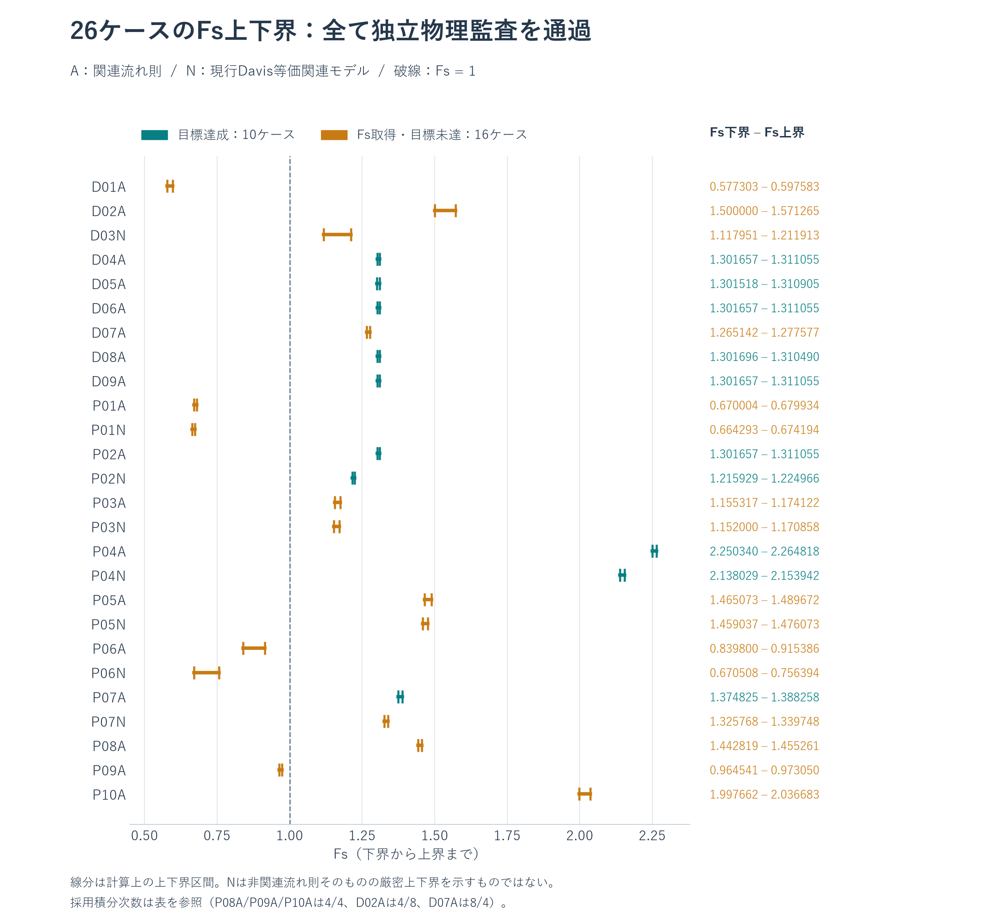
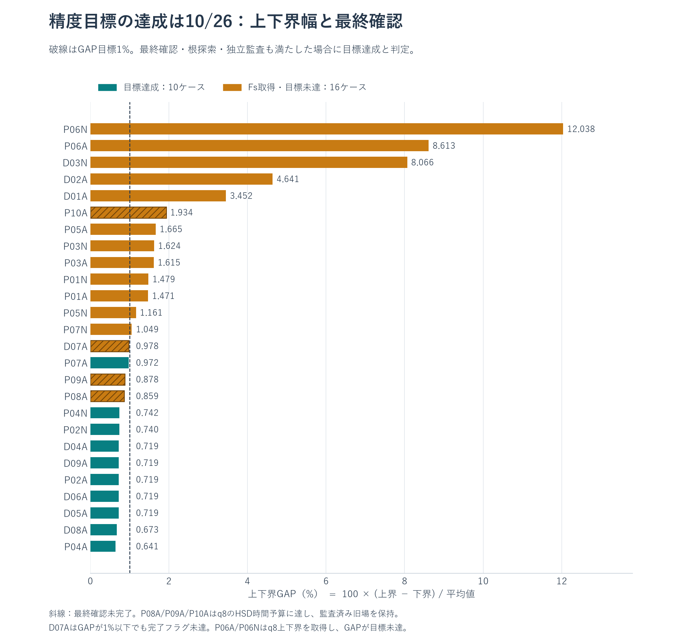
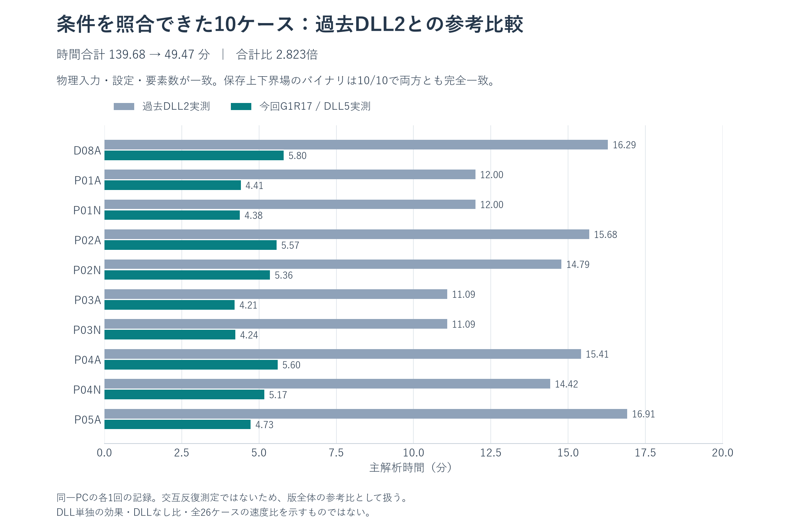

# G1R17・最新DLL5：間隙水圧を含む26ケースの実測結果

2026年10月12日〜13日（日本時間）に、公開G1R17の同じVBA・DLLを使って26ケースを実Excelで順次解析しました。**全26ケースで独立物理監査済みのFs上下界を取得し、目標精度の達成は10ケースでした。** 主解析時間の合計は **7時間46分7秒（27,966.89秒）** です。粗メッシュの固定Fs比較やPythonの実行時間ではなく、ExcelのFs探索・適応解析の実測値です。

[数値CSV](data/RESULTS.csv) / [処理区間別CSV](data/PHASE_TIMINGS.csv) / [機械可読の結果・監査](data/summary.json) / [採用精度の記録](QUALITY_NOTES.md) / **[結果XLSM26冊・共通DLL・入力・原ログ・保存場・監査コードの証拠ZIP（約83 MiB）](https://github.com/tak063495-prog/excel-vba-rpfem/raw/refs/heads/main/downloads/RPFEM_G1R17_Native26_20261012.zip)**

## 計算時間


最長はP06Nの **6,057.42秒（1時間40分57秒）**、P06Aは **6,049.83秒（1時間40分50秒）** でした。この2ケースで総時間の約43.3%を占めます。中央値は **342.13秒（5.70分）**。今回の測定は各ケース1回です。

## Fs上下界と精度目標





線分は計算上の上下界区間で、統計的な信頼区間ではありません。**Nケースは現行Davis等価関連モデルの結果**であり、非関連流れ則そのものの厳密上下界を保証しません。Aケースは関連流れ則です。MC・Davis変換・Fs定義・許容差を変更していません。

「目標達成」は、上下界GAP≦1%、採用場と根探索の有効・完了判定、独立物理監査を満たすケースです。「Fs取得・目標未達」も監査済み上下界を取得していますが、精密な単一Fsとして扱えません。GAPは `100 × (Fs上界 − Fs下界) / ((Fs上界 + Fs下界)/2)`。下表の数値は表示用に丸めており、CSV・JSONに元の精度で保存しています。

| ケース・入力JSON | 主解析秒 | 分 | Fs下界 | Fs上界 | GAP % | 採用q 下/上 | 採用要素数 下/上 | 判定・未達理由 |
|---|---:|---:|---:|---:|---:|---:|---:|---|
| [D01A](data/inputs/D01A.json) | 1862.76 | 31.05 | 0.577303 | 0.597583 | 3.452 | 8/8 | 799/799 | GAP未達 / 下界根探索未達 / 上界根探索未達 |
| [D02A](data/inputs/D02A.json) | 2056.99 | 34.28 | 1.500000 | 1.571265 | 4.641 | 4/8 | 564/876 | GAP未達 / 下界根探索未達 / 上界根探索未達 |
| [D03N](data/inputs/D03N.json) | 2035.13 | 33.92 | 1.117951 | 1.211913 | 8.066 | 8/8 | 874/874 | GAP未達 / 下界根探索未達 / 上界根探索未達 |
| [D04A](data/inputs/D04A.json) | 322.29 | 5.37 | 1.301657 | 1.311055 | 0.719 | 8/8 | 1000/1000 | 目標達成 |
| [D05A](data/inputs/D05A.json) | 363.77 | 6.06 | 1.301518 | 1.310905 | 0.719 | 8/8 | 998/998 | 目標達成 |
| [D06A](data/inputs/D06A.json) | 321.34 | 5.36 | 1.301657 | 1.311055 | 0.719 | 8/8 | 1000/1000 | 目標達成 |
| [D07A](data/inputs/D07A.json) | 265.82 | 4.43 | 1.265142 | 1.277577 | 0.978 | 8/4 | 999/557 | 最終確認未完了 |
| [D08A](data/inputs/D08A.json) | 348.08 | 5.80 | 1.301696 | 1.310490 | 0.673 | 8/8 | 997/997 | 目標達成 |
| [D09A](data/inputs/D09A.json) | 323.32 | 5.39 | 1.301657 | 1.311055 | 0.719 | 8/8 | 1000/1000 | 目標達成 |
| [P01A](data/inputs/P01A.json) | 264.60 | 4.41 | 0.670004 | 0.679934 | 1.471 | 8/8 | 997/997 | GAP未達 |
| [P01N](data/inputs/P01N.json) | 262.75 | 4.38 | 0.664293 | 0.674194 | 1.479 | 8/8 | 995/995 | GAP未達 |
| [P02A](data/inputs/P02A.json) | 334.06 | 5.57 | 1.301657 | 1.311055 | 0.719 | 8/8 | 1000/1000 | 目標達成 |
| [P02N](data/inputs/P02N.json) | 321.35 | 5.36 | 1.215929 | 1.224966 | 0.740 | 8/8 | 1000/1000 | 目標達成 |
| [P03A](data/inputs/P03A.json) | 252.89 | 4.21 | 1.155317 | 1.174122 | 1.615 | 8/8 | 998/998 | GAP未達 |
| [P03N](data/inputs/P03N.json) | 254.11 | 4.24 | 1.152000 | 1.170858 | 1.624 | 8/8 | 998/998 | GAP未達 |
| [P04A](data/inputs/P04A.json) | 336.18 | 5.60 | 2.250340 | 2.264818 | 0.641 | 8/8 | 995/995 | 目標達成 |
| [P04N](data/inputs/P04N.json) | 310.34 | 5.17 | 2.138029 | 2.153942 | 0.742 | 8/8 | 999/999 | 目標達成 |
| [P05A](data/inputs/P05A.json) | 283.86 | 4.73 | 1.465073 | 1.489672 | 1.665 | 8/8 | 551/551 | GAP未達 |
| [P05N](data/inputs/P05N.json) | 552.87 | 9.21 | 1.459037 | 1.476073 | 1.161 | 8/8 | 997/997 | GAP未達 |
| [P06A](data/inputs/P06A.json) | 6049.83 | 100.83 | 0.839800 | 0.915386 | 8.613 | 8/8 | 1000/1000 | GAP未達 |
| [P06N](data/inputs/P06N.json) | 6057.42 | 100.96 | 0.670508 | 0.756394 | 12.038 | 8/8 | 1000/1000 | GAP未達 |
| [P07A](data/inputs/P07A.json) | 547.53 | 9.13 | 1.374825 | 1.388258 | 0.972 | 8/8 | 1000/1000 | 目標達成 |
| [P07N](data/inputs/P07N.json) | 746.87 | 12.45 | 1.325768 | 1.339748 | 1.049 | 8/8 | 998/998 | GAP未達 |
| [P08A](data/inputs/P08A.json) | 1375.34 | 22.92 | 1.442819 | 1.455261 | 0.859 | 4/4 | 998/998 | q8最終HSD予算到達・q4旧場保持 |
| [P09A](data/inputs/P09A.json) | 1127.38 | 18.79 | 0.964541 | 0.973050 | 0.878 | 4/4 | 998/998 | q8最終HSD予算到達・q4旧場保持 |
| [P10A](data/inputs/P10A.json) | 990.00 | 16.50 | 1.997662 | 2.036683 | 1.934 | 4/4 | 1000/1000 | q8最終HSD予算到達・q4旧場保持 / GAP未達 |

26ケースの最終実行時エラー番号はすべて0でした。以下の未達を、解析完了や実行時エラーの有無と区別しています。

- **P06A・P06N**：採用q8上下界が独立監査を通過。GAPは8.613%・12.038%で目標未達です。最終採用メッシュは両ケースとも1,000要素・542節点でした。
- **P08A・P09A・P10A**：q8の最終上界確認がHSDの300秒予算に達し、`FINAL_NUMERICAL_UNKNOWN;OLD_WITNESSES_KEPT HSD_SOLVE_BUDGET_EXCEEDED` を記録。監査済みq4上下界を保持しました。P08A・P09AはGAPが1%以内でも、最終確認未完了なので目標達成に数えません。
- **D07A**：GAPは0.978%ですが、全体完了判定は未達。採用qは下/上=8/4です。
- **D01A・D02A・D03N**：上下界場は監査を通りましたが、GAPと根探索の有効判定が未達です。D02Aの採用qは4/8です。

HSD予算はHSD内の開始時刻から反復境界で検査します。準備や通常求解を含む固定Fs全体の所要時間が300秒を超えただけでは、予算到達とは判定していません。途中の`INFEASIBLE`・`UNBOUNDED`はFs探索で利用する判定であり、その記録だけを実行時エラーとは解釈しません。[ケース別の最終棄却・HSD予算記録](data/quality_notes.json)も保存しています。

## 過去DLL2との参考比較



過去のDLL2実測と物理入力・公開設定・要素数を照合できた10ケースでは、主時間合計が **8380.66秒 → 2968.22秒**、合計比 **2.823倍** でした。下界・上界の保存場バイナリは10/10ケースで両方ともSHA-256が完全一致しました。[照合記録](data/prior_dll2_comparison.json)

これは同一PCの各1回の測定を使う**版全体の参考比較**です。交互反復測定ではなく、DLL単独の効果や全26ケースの速度比を示しません。DLLなしの26ケース全解析は再計測していないため、その基準比は掲載していません。過去の「P06A約10時間」も条件を揃えた比較値として扱っていません。

## 計測条件と検証範囲

| 項目 | 実際の条件 |
|---|---|
| 基準コード | G1R17 commit [`24bb5c1`](https://github.com/tak063495-prog/excel-vba-rpfem/tree/24bb5c1a09cf7c92997c347ad9f0ee6868e28475)、DLL5改訂、ABI `0x00170005` |
| PC・Excel | AMD Ryzen 9 5900X（12コア・24スレッド）、Windows 11 Pro、64bit Excel 16.0 |
| Fs解析設定 | TARGET=1536、ADAPT=1、CYCLES=3、QUADRATURE=8、FS_TOL=1e-4、GAP=0.01 |
| 公開版の上限 | ADAPT_REFINE_CAP=1000、HSD_SOLVE_SECONDS=300 |
| その他 | 自重固定、kh=0、C0_AUTO=0、RAW_LOWER_AUDIT=1、診断ON、試験注入OFF |
| 計測方法 | 1ケースずつ実Excelで順次実行、各ケース1回。26/26で数値DLL呼出しを記録 |
| 主時間 | 診断ログの `run_end.elapsed_s`。Fs探索・適応解析を含む |
| 別計測 | 初期メッシュ、水圧準備、COM側RPX_Run時間。Excel起動終了・保存・独立Python監査は主時間から除外 |
| 結果保全 | 原本から別名XLSMを作成。製品71モジュールは26/26で不変、追加は記録用`BatchEvidence`のみ |

TARGET・CYCLESは要求設定です。最終要素数や適応の成功回数が必ずその値になるという意味ではありません。最終採用要素数とqは上表に記載しました。処理区間別CSVには入れ子の区間があるため、列を足して主解析時間に一致させることはできません。[計測環境](data/environment.json)

**間隙水圧D08A**は地下水位y=3の固定静水圧 `u=9.81*max(3-y,0)`、有効応力連成ON、サクションOFF、γ=20です。露出面が地下水位より上なので追加の外水圧荷重はありません。反復する浸透FEMの検証ではなく、指定した静水圧場の連成解析です。他25ケースは連成OFFです。節点水圧と独立に計算したP1水圧勾配・`b-grad u` を照合しました。

**D04AのE・D09Aのν**は現行の剛塑性モデルの入力ではありません。両ケースも実際に実行していますが、弾性係数・ポアソン比への感度を確認したケースとは数えません。

**独立Python監査**では、保存済み上下界場を使い、材料・領域面積・外周境界・荷重・自重・水圧勾配、下界のMC降伏・平衡・面力、上界の流れ・速度境界・内部面ジャンプ・接着界面・仕事・目的値を再計算しました。下界は元の物理単位で残差≦1e-7を要求し、上下界端点のλ・仕事の方向も確認しました。これは保存場の独立検査であり、26ケース全てをPythonソルバーで再求解したという意味ではありません。[最終照合記録](data/final_verification.json)

今回の掲載ではソルバー・VBA・DLLを変更していません。測定中に保護対象636ファイルが不変だったことを確認し、元ログ・保存場・ハッシュを証拠ZIPへ収録しました。マクロの信頼設定・セキュリティ・レジストリは変更していません。

## 入力・再現・ダウンロード

ケースIDから今回使用した入力JSONを参照できます。タイトルは元入力の記載です。E・νなどのカタログ項目は上記の適用範囲に従って解釈してください。

<details>
<summary>26ケースの入力タイトル</summary>

| ケース | 入力のタイトル |
|---|---|
| [D01A](data/inputs/D01A.json) | All c=0, 45 degree face, phi=30 |
| [D02A](data/inputs/D02A.json) | All c=0, slope ratio 2:3, phi=45 |
| [D03N](data/inputs/D03N.json) | D02 geometry, c=0 nonassociated psi=0 |
| [D04A](data/inputs/D04A.json) | Elastic modulus sensitivity E/10 |
| [D05A](data/inputs/D05A.json) | Geometric similitude: L x1000, gamma /1000 |
| [D06A](data/inputs/D06A.json) | Translation covariance (+1000,+2000) |
| [D07A](data/inputs/D07A.json) | Crest surcharge 20 kPa on x=2..8 |
| [D08A](data/inputs/D08A.json) | Fixed pore pressure field, water elevation y=3 |
| [D09A](data/inputs/D09A.json) | Near-incompressibility diagnostic nu=0.49 |
| [P01A](data/inputs/P01A.json) | Jia2024 / Cheng homogeneous Case 1, psi=0, associated twin |
| [P01N](data/inputs/P01N.json) | Jia2024 / Cheng homogeneous Case 1, psi=0 |
| [P02A](data/inputs/P02A.json) | Jia2024 / Cheng homogeneous Case 2, psi=0, associated twin |
| [P02N](data/inputs/P02N.json) | Jia2024 / Cheng homogeneous Case 2, psi=0 |
| [P03A](data/inputs/P03A.json) | Jia2024 / Cheng homogeneous Case 3, psi=0, associated twin |
| [P03N](data/inputs/P03N.json) | Jia2024 / Cheng homogeneous Case 3, psi=0 |
| [P04A](data/inputs/P04A.json) | Jia2024 / Cheng homogeneous Case 4, psi=0, associated twin |
| [P04N](data/inputs/P04N.json) | Jia2024 / Cheng homogeneous Case 4, psi=0 |
| [P05A](data/inputs/P05A.json) | Three horizontal layers |
| [P05N](data/inputs/P05N.json) | Three horizontal layers |
| [P06A](data/inputs/P06A.json) | Thin frictional weak band, 28 m domain |
| [P06N](data/inputs/P06N.json) | Thin frictional weak band, 28 m domain |
| [P07A](data/inputs/P07A.json) | Griffiths–Lane Example1, D=1 |
| [P07N](data/inputs/P07N.json) | Griffiths–Lane Example1, D=1 |
| [P08A](data/inputs/P08A.json) | Uniform undrained clay |
| [P09A](data/inputs/P09A.json) | Weak clay foundation |
| [P10A](data/inputs/P10A.json) | Clay foundation mechanism transition |

</details>

1. [証拠ZIP](https://github.com/tak063495-prog/excel-vba-rpfem/raw/refs/heads/main/downloads/RPFEM_G1R17_Native26_20261012.zip)をダウンロードし、展開します。`G1R17_native26/workbooks/` に26冊の結果XLSMと共通DLLがあります。ブックの入力・結果を参照するだけなら再解析は不要です。
2. `G1R17_native26/cases/<ID>/` に実Excelの原ログ・状態・保存応力/速度場・独立監査、`inputs/` に入力、`scripts/` に試験コードを収録しています。
3. 再実行はZIP内 `REPRODUCTION_JA.md` の配置・依存関係に従います。基準commitのリポジトリと `versions/G1R13/vendor` も必要で、ZIP単体では自動試験環境は完結しません。元の測定結果を上書きせず別フォルダーを用います。通常の結果ブック利用にPythonやVBAプロジェクトアクセス許可は不要です。

証拠ZIPのSHA-256：

```text
3b65c2f3c2ed20283ae9f052321785a7547988391895cfea37e475082e4f6d62  RPFEM_G1R17_Native26_20261012.zip
```

基準XLSM SHA-256：`dcbfdcfb2d4bbcf382f07d237e77d7122185ebe91c4fce59935cb751f04e2fda`

基準DLL SHA-256：`72aaf9bfccc0acc186eb69cdcbabd93b27f7ce245ceac574193ba6602c675323`

公開用の表・図は記録済み値から生成しています。PythonとNumPy・Matplotlib、日本語フォントを用意し、このフォルダーで `python build_report.py --font <日本語フォントファイル>` を実行すると再生成できます。Excel求解を開始する処理はありません。[掲載内容の照合](PUBLICATION_CHECKS.json)

[G1R17の使い方](../../../versions/G1R17/README.md) / [局所修復の報告](../../../versions/G1R17/REPORT.md) / [リポジトリ先頭](../../../README.md)
