# 検証26ケースの条件（図説）

このページは、G1R12 以降の速度・精度ベンチマーク（例: [G1R17 native26](../benchmarks/G1R17_native26_20261013/README.md)）で使っている26の検証ケースの条件を、図と表でまとめたものです。図と表は、runner が実際に読む入力JSON（[`docs/benchmarks/G1R17_native26_20261013/data/inputs/`](../benchmarks/G1R17_native26_20261013/data/inputs/)）と、ケース定義書 [`Test_Case_Catalog.md`](../../validation/G1R12_native25_20261009/Test_Case_Catalog.md) から自動生成しています（[`tools/`](tools/)）。

## 共通条件

- 単位 m, kN, kPa, 度。平面ひずみ、単位奥行 1 m。Mohr–Coulomb 材料。強度低減法で安全率 Fs の下界・上界を求める。
- 境界: 底面は固定XY（赤）、左右の鉛直端は固定X＝水平変位拘束（青）、その他の露出面は自由。P07 は右鉛直端を持たない。
- 地震（水平震度 kh）は全ケース 0。間隙水圧は D08A のみ。上載荷重は D07A のみ。追加の引張カットオフはなし。
- 図の材料色: ケース内の材料順に 茶→緑→灰。P08A は斜面と基礎が同じ強度だが領域を分けて表示している。

## 命名規則

- 先頭文字: **P** = 文献（Paper）由来のケース、**D** = 独自設計の診断（Diagnostic）ケース。番号は形状・材料の組。
- 末尾文字: **A** = 関連流れ則（ψ=φ）。**N** = 非関連流れ則（文献のψ。ソルバー内では Davis 等価の関連モデル `DAVIS_EQUIVALENT` で扱う）。
- 文献記号: R02 = Jia ほか 2024（eSPFEM、Cheng 2007 などの比較表を含む）、R03 = Griffiths & Lane（Example1〜4）、R10・R11 = P06 の形状照合に使った文献。正式な書誌情報は repo 内に見当たらないため記載していない（カタログでは `Source_Audit.md / sources.json` を参照としているが未収録）。
- 由来区分: `literature_geometry_parameters`=文献の形状・定数そのまま、`derived_associated_twin`=N ケースの関連版（参照Fsはコピーしない）、`nondimensional_literature_case_dimensionalized`=無次元の文献ケースに寸法を与えたもの、`designed_diagnostic`=診断用の設計ケース。

## 全体図

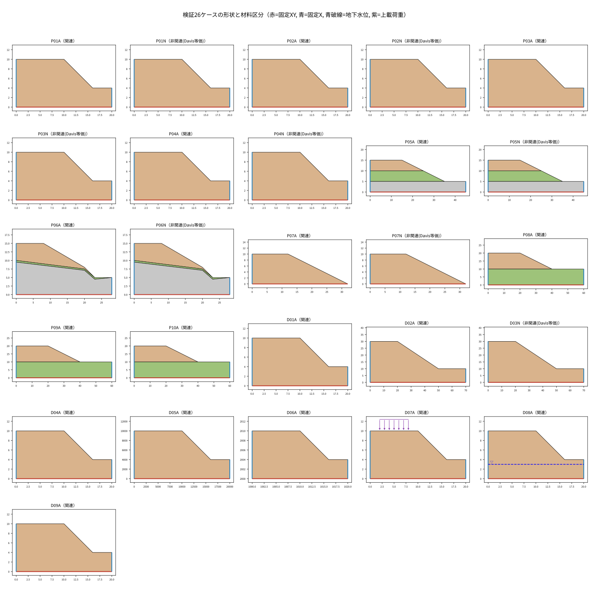

## 一覧

| ID | 名称 | 形状 | 材料（c kPa, φ°, ψ°, γ kN/m³） | 水 | 荷重 | 流れ則 | 参照Fs | 目的 |
|---|---|---|---|---|---|---|---|---|
| [P01A](#p01a) | Jia2024 / Cheng homogeneous Case 1, psi=0, associated twin | 幅20×高10 m | soil c=10 φ=5 ψ=5 γ=20 | なし | なし | 関連（ψ=φ） | 記載なし | 均質斜面 Case1（低φ=5°）。文献Fs≈0.65〜0.70 |
| [P01N](#p01n) | Jia2024 / Cheng homogeneous Case 1, psi=0 | 幅20×高10 m | soil c=10 φ=5 ψ=0 γ=20 | なし | なし | 非関連（Davis等価） | 0.65〜0.7 | 均質斜面 Case1（低φ=5°）。文献Fs≈0.65〜0.70 |
| [P02A](#p02a) | Jia2024 / Cheng homogeneous Case 2, psi=0, associated twin | 幅20×高10 m | soil c=10 φ=25 ψ=25 γ=20 | なし | なし | 関連（ψ=φ） | 記載なし | 均質斜面 Case2（φ=25°）。文献Fs≈1.30〜1.36 |
| [P02N](#p02n) | Jia2024 / Cheng homogeneous Case 2, psi=0 | 幅20×高10 m | soil c=10 φ=25 ψ=0 γ=20 | なし | なし | 非関連（Davis等価） | 1.3〜1.36 | 均質斜面 Case2（φ=25°）。文献Fs≈1.30〜1.36 |
| [P03A](#p03a) | Jia2024 / Cheng homogeneous Case 3, psi=0, associated twin | 幅20×高10 m | soil c=20 φ=5 ψ=5 γ=20 | なし | なし | 関連（ψ=φ） | 記載なし | 均質斜面 Case3。文献Fs≈1.06〜1.20 |
| [P03N](#p03n) | Jia2024 / Cheng homogeneous Case 3, psi=0 | 幅20×高10 m | soil c=20 φ=5 ψ=0 γ=20 | なし | なし | 非関連（Davis等価） | 1.06〜1.2 | 均質斜面 Case3。文献Fs≈1.06〜1.20 |
| [P04A](#p04a) | Jia2024 / Cheng homogeneous Case 4, psi=0, associated twin | 幅20×高10 m | soil c=20 φ=35 ψ=35 γ=20 | なし | なし | 関連（ψ=φ） | 記載なし | 均質斜面 Case4（高Fs）。文献Fs≈2.24〜2.34 |
| [P04N](#p04n) | Jia2024 / Cheng homogeneous Case 4, psi=0 | 幅20×高10 m | soil c=20 φ=35 ψ=0 γ=20 | なし | なし | 非関連（Davis等価） | 2.24〜2.34 | 均質斜面 Case4（高Fs）。文献Fs≈2.24〜2.34 |
| [P05A](#p05a) | Three horizontal layers | 幅45×高15 m | upper c=14 φ=18 ψ=18 γ=18; middle c=16.8 φ=20 ψ=20 γ=19.5; base c=1.9 φ=23 ψ=23 γ=21 | なし | なし | 関連（ψ=φ） | 記載なし | 3層水平成層斜面（保留評価群） |
| [P05N](#p05n) | Three horizontal layers | 幅45×高15 m | upper c=14 φ=18 ψ=9 γ=18; middle c=16.8 φ=20 ψ=9 γ=19.5; base c=1.9 φ=23 ψ=9 γ=21 | なし | なし | 非関連（Davis等価） | 1.7〜1.725 | 3層水平成層斜面（保留評価群） |
| [P06A](#p06a) | Thin frictional weak band, 28 m domain | 幅28×高15 m | upper c=20 φ=35 ψ=35 γ=19; band c=0 φ=25 ψ=25 γ=19; base c=10 φ=35 ψ=35 γ=19 | なし | なし | 関連（ψ=φ） | 記載なし | 薄い摩擦性弱層（c=0, φ=25°）を含む斜面（保留評価群） |
| [P06N](#p06n) | Thin frictional weak band, 28 m domain | 幅28×高15 m | upper c=20 φ=35 ψ=0 γ=19; band c=0 φ=25 ψ=0 γ=19; base c=10 φ=35 ψ=0 γ=19 | なし | なし | 非関連（Davis等価） | 0.86〜0.927 | 薄い摩擦性弱層（c=0, φ=25°）を含む斜面（保留評価群） |
| [P07A](#p07a) | Griffiths–Lane Example1, D=1 | 幅32×高10 m | soil c=10 φ=20 ψ=20 γ=20 | なし | なし | 関連（ψ=φ） | 記載なし | Griffiths–Lane Example1（D=1、基礎なし） |
| [P07N](#p07n) | Griffiths–Lane Example1, D=1 | 幅32×高10 m | soil c=10 φ=20 ψ=0 γ=20 | なし | なし | 非関連（Davis等価） | 1.35〜1.4 | Griffiths–Lane Example1（D=1、基礎なし） |
| [P08A](#p08a) | Uniform undrained clay | 幅60×高20 m | slope c=50 φ=0 ψ=0 γ=20; foundation c=50 φ=0 ψ=0 γ=20 | なし | なし | 関連（ψ=φ） | 1.47 | 均質非排水粘土（φ=0, Tresca相当） |
| [P09A](#p09a) | Weak clay foundation | 幅60×高20 m | slope c=50 φ=0 ψ=0 γ=20; foundation c=30 φ=0 ψ=0 γ=20 | なし | なし | 関連（ψ=φ） | 記載なし | 軟弱粘土基礎（基礎cu=30 < 斜面cu=50、保留評価群） |
| [P10A](#p10a) | Clay foundation mechanism transition | 幅60×高20 m | slope c=50 φ=0 ψ=0 γ=20; foundation c=75 φ=0 ψ=0 γ=20 | なし | なし | 関連（ψ=φ） | 記載なし | 硬い粘土基礎（基礎cu=75）で破壊機構が変わる場合（保留評価群） |
| [D01A](#d01a) | All c=0, 45 degree face, phi=30 | 幅20×高10 m | soil c=0 φ=30 ψ=30 γ=20 | なし | なし | 関連（ψ=φ） | 記載なし | c=0・45°法面・φ=30°（上界の適格性検査群） |
| [D02A](#d02a) | All c=0, slope ratio 2:3, phi=45 | 幅70×高30 m | soil c=0 φ=45 ψ=45 γ=20 | なし | なし | 関連（ψ=φ） | 記載なし | c=0・勾配2:3・φ=45°（表層滑り極限機構 tan45°/tan(arctan(2/3))=1.5 との照合） |
| [D03N](#d03n) | D02 geometry, c=0 nonassociated psi=0 | 幅70×高30 m | soil c=0 φ=45 ψ=0 γ=20 | なし | なし | 非関連（Davis等価） | 記載なし | D02と同形状の非関連（ψ=0）版（異常系/不変性） |
| [D04A](#d04a) | Elastic modulus sensitivity E/10 | 幅20×高10 m | soil c=10 φ=25 ψ=25 γ=20 | なし | なし | 関連（ψ=φ） | 記載なし | 弾性係数E/10の感度（Eは剛塑性モデルの入力ではないが実際に実行する） |
| [D05A](#d05a) | Geometric similitude: L x1000, gamma /1000 | 幅20000×高10000 m | soil c=10 φ=25 ψ=25 γ=0.02 | なし | なし | 関連（ψ=φ） | 記載なし | 幾何相似（長さ×1000, γ/1000）。理想FsはP02Aと同じ |
| [D06A](#d06a) | Translation covariance (+1000,+2000) | 幅20×高10 m | soil c=10 φ=25 ψ=25 γ=20 | なし | なし | 関連（ψ=φ） | 記載なし | 平行移動（+1000,+2000）。FsはP02Aと同じはず |
| [D07A](#d07a) | Crest surcharge 20 kPa on x=2..8 | 幅20×高10 m | soil c=10 φ=25 ψ=25 γ=20 | なし | 天端 20 kPa（x=2〜8） | 関連（ψ=φ） | 記載なし | 天端上載荷重20 kPa（x=2〜8） |
| [D08A](#d08a) | Fixed pore pressure field, water elevation y=3 | 幅20×高10 m | soil c=10 φ=25 ψ=25 γ=20 | 静水圧 水位y=3 m | なし | 関連（ψ=φ） | 記載なし | 固定静水圧間隙水圧場（水位y=3） |
| [D09A](#d09a) | Near-incompressibility diagnostic nu=0.49 | 幅20×高10 m | soil c=10 φ=25 ψ=25 γ=20 | なし | なし | 関連（ψ=φ） | 記載なし | ほぼ非圧縮 ν=0.49（νは剛塑性モデルの入力ではないが実際に実行する） |

## ケース別の条件

### P01A

- 名称: Jia2024 / Cheng homogeneous Case 1, psi=0, associated twin
- 目的: 均質斜面 Case1（低φ=5°）。文献Fs≈0.65〜0.70
- 文献/由来: R02 / derived_associated_twin（出典箇所: p8 Fig3 Table1）
- 外形（反時計回り, m）: `(0, 0) → (20, 0) → (20, 4) → (16, 4) → (10, 10) → (0, 10)`
- 面積: 158 m² ／ 総重量: 3160 kN/m ／ メッシュ目標h (M0/M1/M2): 1.25 / 0.625 / 0.3125 m
- 流れ則: 関連（ψ=φ）（ψ政策 `equal_reduced_phi`）
- 水: なし ／ 地震: kh=0（なし） ／ 荷重: なし
- 境界: 底面 固定XY、左右鉛直端 固定X（鉛直ローラー）、その他 自由

| 材料 | E (kPa) | ν | γ (kN/m³) | c (kPa) | φ (°) | ψ (°) |
|---|---:|---:|---:|---:|---:|---:|
| soil | 14000 | 0.3 | 20 | 10 | 5 | 5 |

参照Fs: 記載なし（派生/診断入力のため元ケースの値をコピーしていない）

補足仮定・制限（カタログ原文）:

- R02 uses explicit large-deformation SPFEM; compare failure onset, not its 6 s final displacement.
- No explicit tensile cap was specified in the inspected benchmark description; this input adds none.
- Fs<1 must be allowed; the independent-gravity trial profile is an explicit static-FEM adaptation.

### P01N

- 名称: Jia2024 / Cheng homogeneous Case 1, psi=0
- 目的: 均質斜面 Case1（低φ=5°）。文献Fs≈0.65〜0.70
- 文献/由来: R02 / literature_geometry_parameters（出典箇所: p8 Fig3 Table1）
- 外形（反時計回り, m）: `(0, 0) → (20, 0) → (20, 4) → (16, 4) → (10, 10) → (0, 10)`
- 面積: 158 m² ／ 総重量: 3160 kN/m ／ メッシュ目標h (M0/M1/M2): 1.25 / 0.625 / 0.3125 m
- 流れ則: 非関連（Davis等価）（ψ政策 `hold_initial`）
- 水: なし ／ 地震: kh=0（なし） ／ 荷重: なし
- 境界: 底面 固定XY、左右鉛直端 固定X（鉛直ローラー）、その他 自由

| 材料 | E (kPa) | ν | γ (kN/m³) | c (kPa) | φ (°) | ψ (°) |
|---|---:|---:|---:|---:|---:|---:|
| soil | 14000 | 0.3 | 20 | 10 | 5 | 0 |

参照Fs（文献の方法別報告値。本メッシュの保証値ではない）:

| 方法 | Fs | 出典 |
|---|---:|---|
| Cheng2007_LEM | 0.65 | R02 Table 1 |
| Cheng2007_FEM | 0.69 | R02 Table 1 |
| Zhou2022_LB_as_reported | 0.68 | R02 Table 1 |
| Zhou2022_UB_as_reported | 0.7 | R02 Table 1 |
| Zhou2022_SOCP | 0.69 | R02 Table 1 |
| Wang2021_SOCP | 0.67 | R02 Table 1 |
| Jia2024_eSPFEM | 0.68 | R02 Table 1 |

補足仮定・制限（カタログ原文）:

- R02 uses explicit large-deformation SPFEM; compare failure onset, not its 6 s final displacement.
- No explicit tensile cap was specified in the inspected benchmark description; this input adds none.
- Fs<1 must be allowed; the independent-gravity trial profile is an explicit static-FEM adaptation.

### P02A

- 名称: Jia2024 / Cheng homogeneous Case 2, psi=0, associated twin
- 目的: 均質斜面 Case2（φ=25°）。文献Fs≈1.30〜1.36
- 文献/由来: R02 / derived_associated_twin（出典箇所: p8 Fig3 Table1）
- 外形（反時計回り, m）: `(0, 0) → (20, 0) → (20, 4) → (16, 4) → (10, 10) → (0, 10)`
- 面積: 158 m² ／ 総重量: 3160 kN/m ／ メッシュ目標h (M0/M1/M2): 1.25 / 0.625 / 0.3125 m
- 流れ則: 関連（ψ=φ）（ψ政策 `equal_reduced_phi`）
- 水: なし ／ 地震: kh=0（なし） ／ 荷重: なし
- 境界: 底面 固定XY、左右鉛直端 固定X（鉛直ローラー）、その他 自由

| 材料 | E (kPa) | ν | γ (kN/m³) | c (kPa) | φ (°) | ψ (°) |
|---|---:|---:|---:|---:|---:|---:|
| soil | 14000 | 0.3 | 20 | 10 | 25 | 25 |

参照Fs: 記載なし（派生/診断入力のため元ケースの値をコピーしていない）

補足仮定・制限（カタログ原文）:

- R02 uses explicit large-deformation SPFEM; compare failure onset, not its 6 s final displacement.
- No explicit tensile cap was specified in the inspected benchmark description; this input adds none.
- Fs<1 must be allowed; the independent-gravity trial profile is an explicit static-FEM adaptation.

### P02N

- 名称: Jia2024 / Cheng homogeneous Case 2, psi=0
- 目的: 均質斜面 Case2（φ=25°）。文献Fs≈1.30〜1.36
- 文献/由来: R02 / literature_geometry_parameters（出典箇所: p8 Fig3 Table1）
- 外形（反時計回り, m）: `(0, 0) → (20, 0) → (20, 4) → (16, 4) → (10, 10) → (0, 10)`
- 面積: 158 m² ／ 総重量: 3160 kN/m ／ メッシュ目標h (M0/M1/M2): 1.25 / 0.625 / 0.3125 m
- 流れ則: 非関連（Davis等価）（ψ政策 `hold_initial`）
- 水: なし ／ 地震: kh=0（なし） ／ 荷重: なし
- 境界: 底面 固定XY、左右鉛直端 固定X（鉛直ローラー）、その他 自由

| 材料 | E (kPa) | ν | γ (kN/m³) | c (kPa) | φ (°) | ψ (°) |
|---|---:|---:|---:|---:|---:|---:|
| soil | 14000 | 0.3 | 20 | 10 | 25 | 0 |

参照Fs（文献の方法別報告値。本メッシュの保証値ではない）:

| 方法 | Fs | 出典 |
|---|---:|---|
| Cheng2007_LEM | 1.3 | R02 Table 1 |
| Cheng2007_FEM | 1.36 | R02 Table 1 |
| Zhou2022_LB_as_reported | 1.31 | R02 Table 1 |
| Zhou2022_UB_as_reported | 1.36 | R02 Table 1 |
| Zhou2022_SOCP | 1.33 | R02 Table 1 |
| Wang2021_SOCP | 1.32 | R02 Table 1 |
| Jia2024_eSPFEM | 1.3 | R02 Table 1 |

補足仮定・制限（カタログ原文）:

- R02 uses explicit large-deformation SPFEM; compare failure onset, not its 6 s final displacement.
- No explicit tensile cap was specified in the inspected benchmark description; this input adds none.
- Fs<1 must be allowed; the independent-gravity trial profile is an explicit static-FEM adaptation.

### P03A

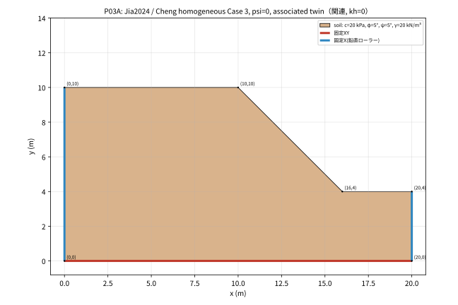

- 名称: Jia2024 / Cheng homogeneous Case 3, psi=0, associated twin
- 目的: 均質斜面 Case3。文献Fs≈1.06〜1.20
- 文献/由来: R02 / derived_associated_twin（出典箇所: p8 Fig3 Table1）
- 外形（反時計回り, m）: `(0, 0) → (20, 0) → (20, 4) → (16, 4) → (10, 10) → (0, 10)`
- 面積: 158 m² ／ 総重量: 3160 kN/m ／ メッシュ目標h (M0/M1/M2): 1.25 / 0.625 / 0.3125 m
- 流れ則: 関連（ψ=φ）（ψ政策 `equal_reduced_phi`）
- 水: なし ／ 地震: kh=0（なし） ／ 荷重: なし
- 境界: 底面 固定XY、左右鉛直端 固定X（鉛直ローラー）、その他 自由

| 材料 | E (kPa) | ν | γ (kN/m³) | c (kPa) | φ (°) | ψ (°) |
|---|---:|---:|---:|---:|---:|---:|
| soil | 14000 | 0.3 | 20 | 20 | 5 | 5 |

参照Fs: 記載なし（派生/診断入力のため元ケースの値をコピーしていない）

補足仮定・制限（カタログ原文）:

- R02 uses explicit large-deformation SPFEM; compare failure onset, not its 6 s final displacement.
- No explicit tensile cap was specified in the inspected benchmark description; this input adds none.
- Fs<1 must be allowed; the independent-gravity trial profile is an explicit static-FEM adaptation.

### P03N

- 名称: Jia2024 / Cheng homogeneous Case 3, psi=0
- 目的: 均質斜面 Case3。文献Fs≈1.06〜1.20
- 文献/由来: R02 / literature_geometry_parameters（出典箇所: p8 Fig3 Table1）
- 外形（反時計回り, m）: `(0, 0) → (20, 0) → (20, 4) → (16, 4) → (10, 10) → (0, 10)`
- 面積: 158 m² ／ 総重量: 3160 kN/m ／ メッシュ目標h (M0/M1/M2): 1.25 / 0.625 / 0.3125 m
- 流れ則: 非関連（Davis等価）（ψ政策 `hold_initial`）
- 水: なし ／ 地震: kh=0（なし） ／ 荷重: なし
- 境界: 底面 固定XY、左右鉛直端 固定X（鉛直ローラー）、その他 自由

| 材料 | E (kPa) | ν | γ (kN/m³) | c (kPa) | φ (°) | ψ (°) |
|---|---:|---:|---:|---:|---:|---:|
| soil | 14000 | 0.3 | 20 | 20 | 5 | 0 |

参照Fs（文献の方法別報告値。本メッシュの保証値ではない）:

| 方法 | Fs | 出典 |
|---|---:|---|
| Cheng2007_LEM | 1.06 | R02 Table 1 |
| Cheng2007_FEM | 1.2 | R02 Table 1 |
| Zhou2022_LB_as_reported | 1.18 | R02 Table 1 |
| Zhou2022_UB_as_reported | 1.2 | R02 Table 1 |
| Zhou2022_SOCP | 1.19 | R02 Table 1 |
| Wang2021_SOCP | 1.16 | R02 Table 1 |
| Jia2024_eSPFEM | 1.18 | R02 Table 1 |

補足仮定・制限（カタログ原文）:

- R02 uses explicit large-deformation SPFEM; compare failure onset, not its 6 s final displacement.
- No explicit tensile cap was specified in the inspected benchmark description; this input adds none.
- Fs<1 must be allowed; the independent-gravity trial profile is an explicit static-FEM adaptation.

### P04A

- 名称: Jia2024 / Cheng homogeneous Case 4, psi=0, associated twin
- 目的: 均質斜面 Case4（高Fs）。文献Fs≈2.24〜2.34
- 文献/由来: R02 / derived_associated_twin（出典箇所: p8 Fig3 Table1）
- 外形（反時計回り, m）: `(0, 0) → (20, 0) → (20, 4) → (16, 4) → (10, 10) → (0, 10)`
- 面積: 158 m² ／ 総重量: 3160 kN/m ／ メッシュ目標h (M0/M1/M2): 1.25 / 0.625 / 0.3125 m
- 流れ則: 関連（ψ=φ）（ψ政策 `equal_reduced_phi`）
- 水: なし ／ 地震: kh=0（なし） ／ 荷重: なし
- 境界: 底面 固定XY、左右鉛直端 固定X（鉛直ローラー）、その他 自由

| 材料 | E (kPa) | ν | γ (kN/m³) | c (kPa) | φ (°) | ψ (°) |
|---|---:|---:|---:|---:|---:|---:|
| soil | 14000 | 0.3 | 20 | 20 | 35 | 35 |

参照Fs: 記載なし（派生/診断入力のため元ケースの値をコピーしていない）

補足仮定・制限（カタログ原文）:

- R02 uses explicit large-deformation SPFEM; compare failure onset, not its 6 s final displacement.
- No explicit tensile cap was specified in the inspected benchmark description; this input adds none.
- Fs<1 must be allowed; the independent-gravity trial profile is an explicit static-FEM adaptation.

### P04N

- 名称: Jia2024 / Cheng homogeneous Case 4, psi=0
- 目的: 均質斜面 Case4（高Fs）。文献Fs≈2.24〜2.34
- 文献/由来: R02 / literature_geometry_parameters（出典箇所: p8 Fig3 Table1）
- 外形（反時計回り, m）: `(0, 0) → (20, 0) → (20, 4) → (16, 4) → (10, 10) → (0, 10)`
- 面積: 158 m² ／ 総重量: 3160 kN/m ／ メッシュ目標h (M0/M1/M2): 1.25 / 0.625 / 0.3125 m
- 流れ則: 非関連（Davis等価）（ψ政策 `hold_initial`）
- 水: なし ／ 地震: kh=0（なし） ／ 荷重: なし
- 境界: 底面 固定XY、左右鉛直端 固定X（鉛直ローラー）、その他 自由

| 材料 | E (kPa) | ν | γ (kN/m³) | c (kPa) | φ (°) | ψ (°) |
|---|---:|---:|---:|---:|---:|---:|
| soil | 14000 | 0.3 | 20 | 20 | 35 | 0 |

参照Fs（文献の方法別報告値。本メッシュの保証値ではない）:

| 方法 | Fs | 出典 |
|---|---:|---|
| Cheng2007_LEM | 2.24 | R02 Table 1 |
| Cheng2007_FEM | 2.28 | R02 Table 1 |
| Zhou2022_LB_as_reported | 2.26 | R02 Table 1 |
| Zhou2022_UB_as_reported | 2.34 | R02 Table 1 |
| Zhou2022_SOCP | 2.3 | R02 Table 1 |
| Wang2021_SOCP | 2.24 | R02 Table 1 |
| Jia2024_eSPFEM | 2.27 | R02 Table 1 |

補足仮定・制限（カタログ原文）:

- R02 uses explicit large-deformation SPFEM; compare failure onset, not its 6 s final displacement.
- No explicit tensile cap was specified in the inspected benchmark description; this input adds none.
- Fs<1 must be allowed; the independent-gravity trial profile is an explicit static-FEM adaptation.

### P05A

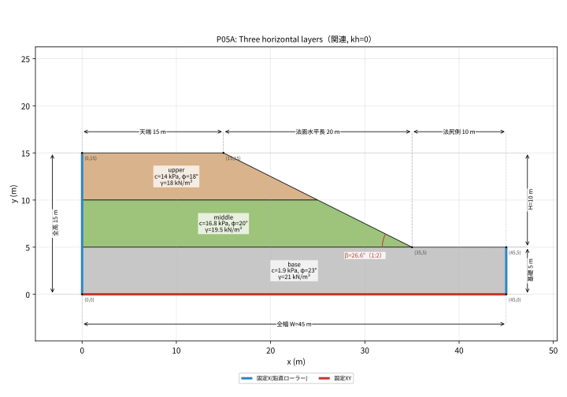

- 名称: Three horizontal layers
- 目的: 3層水平成層斜面（保留評価群）
- 文献/由来: R02 / derived_associated_twin（出典箇所: p13 Fig10 Tables3–4）
- 外形（反時計回り, m）: `(0, 0) → (45, 0) → (45, 5) → (35, 5) → (15, 15) → (0, 15)`
- 面積: 475 m² ／ 総重量: 9450 kN/m ／ メッシュ目標h (M0/M1/M2): 1.875 / 0.9375 / 0.46875 m
- 流れ則: 関連（ψ=φ）（ψ政策 `equal_reduced_phi`）
- 水: なし ／ 地震: kh=0（なし） ／ 荷重: なし
- 境界: 底面 固定XY、左右鉛直端 固定X（鉛直ローラー）、その他 自由

| 材料 | E (kPa) | ν | γ (kN/m³) | c (kPa) | φ (°) | ψ (°) |
|---|---:|---:|---:|---:|---:|---:|
| upper | 60000 | 0.3 | 18 | 14 | 18 | 18 |
| middle | 80000 | 0.3 | 19.5 | 16.8 | 20 | 20 |
| base | 100000 | 0.3 | 21 | 1.9 | 23 | 23 |

参照Fs: 記載なし（派生/診断入力のため元ケースの値をコピーしていない）

補足仮定・制限（カタログ原文）:

- R02 lists initial psi=9 degrees but its reduction policy is not fully specified here; N version explicitly holds psi=9.
- Slope ratio 1:2 is used exactly; the printed 26.57 degrees is rounded.

### P05N

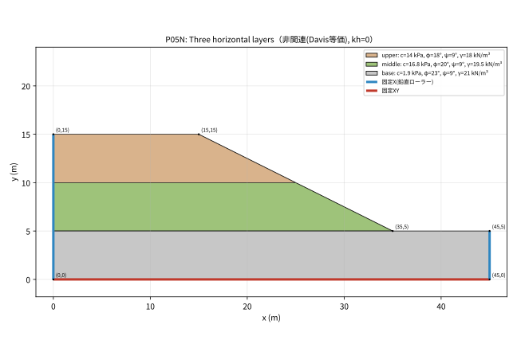

- 名称: Three horizontal layers
- 目的: 3層水平成層斜面（保留評価群）
- 文献/由来: R02 / literature_with_explicit_psi_policy（出典箇所: p13 Fig10 Tables3–4）
- 外形（反時計回り, m）: `(0, 0) → (45, 0) → (45, 5) → (35, 5) → (15, 15) → (0, 15)`
- 面積: 475 m² ／ 総重量: 9450 kN/m ／ メッシュ目標h (M0/M1/M2): 1.875 / 0.9375 / 0.46875 m
- 流れ則: 非関連（Davis等価）（ψ政策 `hold_initial`）
- 水: なし ／ 地震: kh=0（なし） ／ 荷重: なし
- 境界: 底面 固定XY、左右鉛直端 固定X（鉛直ローラー）、その他 自由

| 材料 | E (kPa) | ν | γ (kN/m³) | c (kPa) | φ (°) | ψ (°) |
|---|---:|---:|---:|---:|---:|---:|
| upper | 60000 | 0.3 | 18 | 14 | 18 | 9 |
| middle | 80000 | 0.3 | 19.5 | 16.8 | 20 | 9 |
| base | 100000 | 0.3 | 21 | 1.9 | 23 | 9 |

参照Fs（文献の方法別報告値。本メッシュの保証値ではない）:

| 方法 | Fs | 出典 |
|---|---:|---|
| LEM | 1.725 | R02 Table4 |
| FEM/SPH/XMPM | 1.7 | R02 Table4 |
| eSPFEM | 1.72 | R02 Table4 |

補足仮定・制限（カタログ原文）:

- R02 lists initial psi=9 degrees but its reduction policy is not fully specified here; N version explicitly holds psi=9.
- Slope ratio 1:2 is used exactly; the printed 26.57 degrees is rounded.

### P06A

- 名称: Thin frictional weak band, 28 m domain
- 目的: 薄い摩擦性弱層（c=0, φ=25°）を含む斜面（保留評価群）
- 文献/由来: R02, R10, R11 / cross_checked_geometry_with_unreported_tensile_policy（出典箇所: R02 p14 Fig12 Tables5–6; R10 printed p210 Fig1 mirrored x -> 28-x）
- 外形（反時計回り, m）: `(0, 0) → (28, 0) → (28, 5) → (23, 5) → (20, 8) → (8, 15) → (0, 15)`
- 面積: 302.5 m² ／ 総重量: 5747.5 kN/m ／ メッシュ目標h (M0/M1/M2): 1.875 / 0.9375 / 0.46875 m
- 流れ則: 関連（ψ=φ）（ψ政策 `equal_reduced_phi`）
- 水: なし ／ 地震: kh=0（なし） ／ 荷重: なし
- 境界: 底面 固定XY、左右鉛直端 固定X（鉛直ローラー）、その他 自由

| 材料 | E (kPa) | ν | γ (kN/m³) | c (kPa) | φ (°) | ψ (°) |
|---|---:|---:|---:|---:|---:|---:|
| upper | 14000 | 0.3 | 19 | 20 | 35 | 35 |
| band | 14000 | 0.3 | 19 | 0 | 25 | 25 |
| base | 14000 | 0.3 | 19 | 10 | 35 | 35 |

参照Fs: 記載なし（派生/診断入力のため元ケースの値をコピーしていない）

補足仮定・制限（カタログ原文）:

- The lower band boundary continues from (23,4.5) to (28,5); the vendor coordinate figure resolves the faint end in R02.
- R10 vendor comparisons use model-specific tensile settings not fully stated by R02; none_explicit is an adopted policy, not an exact vendor reproduction.
- Do not force agreement with 0.90 by adding a cap or changing dilation silently.

### P06N

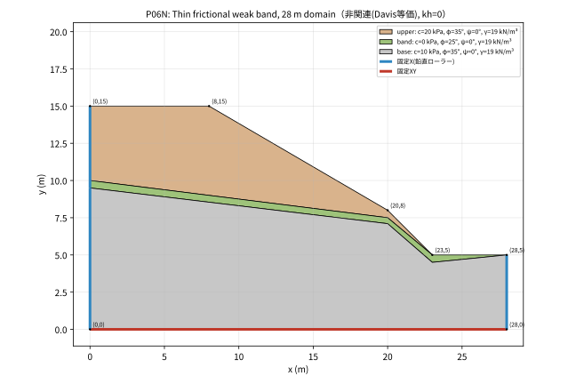

- 名称: Thin frictional weak band, 28 m domain
- 目的: 薄い摩擦性弱層（c=0, φ=25°）を含む斜面（保留評価群）
- 文献/由来: R02, R10, R11 / cross_checked_geometry_with_unreported_tensile_policy（出典箇所: R02 p14 Fig12 Tables5–6; R10 printed p210 Fig1 mirrored x -> 28-x）
- 外形（反時計回り, m）: `(0, 0) → (28, 0) → (28, 5) → (23, 5) → (20, 8) → (8, 15) → (0, 15)`
- 面積: 302.5 m² ／ 総重量: 5747.5 kN/m ／ メッシュ目標h (M0/M1/M2): 1.875 / 0.9375 / 0.46875 m
- 流れ則: 非関連（Davis等価）（ψ政策 `hold_initial`）
- 水: なし ／ 地震: kh=0（なし） ／ 荷重: なし
- 境界: 底面 固定XY、左右鉛直端 固定X（鉛直ローラー）、その他 自由

| 材料 | E (kPa) | ν | γ (kN/m³) | c (kPa) | φ (°) | ψ (°) |
|---|---:|---:|---:|---:|---:|---:|
| upper | 14000 | 0.3 | 19 | 20 | 35 | 0 |
| band | 14000 | 0.3 | 19 | 0 | 25 | 0 |
| base | 14000 | 0.3 | 19 | 10 | 35 | 0 |

参照Fs（文献の方法別報告値。本メッシュの保証値ではない）:

| 方法 | Fs | 出典 |
|---|---:|---|
| LEM | 0.927 | R02 Table6 |
| FEM | 0.86 | R02 Table6 |
| eSPFEM | 0.9 | R02 Table6 |

補足仮定・制限（カタログ原文）:

- The lower band boundary continues from (23,4.5) to (28,5); the vendor coordinate figure resolves the faint end in R02.
- R10 vendor comparisons use model-specific tensile settings not fully stated by R02; none_explicit is an adopted policy, not an exact vendor reproduction.
- Do not force agreement with 0.90 by adding a cap or changing dilation silently.

### P07A

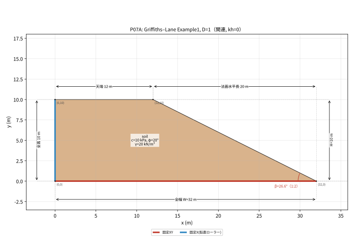

- 名称: Griffiths–Lane Example1, D=1
- 目的: Griffiths–Lane Example1（D=1、基礎なし）
- 文献/由来: R03 / nondimensional_literature_case_dimensionalized（出典箇所: Example1, Fig1, Table2, Fig2）
- 外形（反時計回り, m）: `(0, 0) → (32, 0) → (12, 10) → (0, 10)`
- 面積: 220 m² ／ 総重量: 4400 kN/m ／ メッシュ目標h (M0/M1/M2): 1.25 / 0.625 / 0.3125 m
- 流れ則: 関連（ψ=φ）（ψ政策 `equal_reduced_phi`）
- 水: なし ／ 地震: kh=0（なし） ／ 荷重: なし
- 境界: 底面 固定XY、左右鉛直端 固定X（鉛直ローラー）、その他 自由（右鉛直端なし）

| 材料 | E (kPa) | ν | γ (kN/m³) | c (kPa) | φ (°) | ψ (°) |
|---|---:|---:|---:|---:|---:|---:|
| soil | 100000 | 0.3 | 20 | 10 | 20 | 20 |

参照Fs: 記載なし（派生/診断入力のため元ケースの値をコピーしていない）

補足仮定・制限（カタログ原文）:

- H=10 m and gamma=20 kN/m3 are chosen dimensionalization; c/(gamma H)=0.05; crest width=1.2H; slope run=2H.
- E=100000 kPa and nu=0.3 are the nominal implementation values adopted here, not a claim of identical archived author input.
- R03 uses nonassociated psi=0; A is a separately labeled associated twin.
- No right roller is added: the toe lies at the fixed bottom endpoint.

### P07N

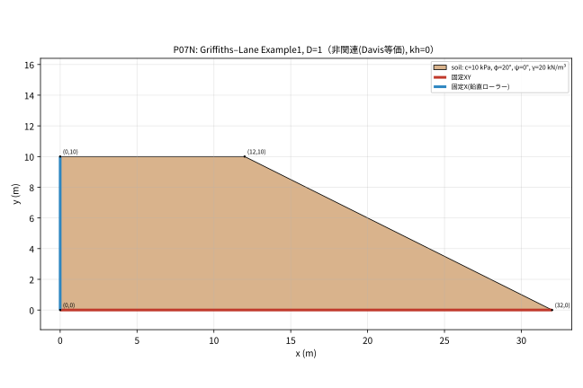

- 名称: Griffiths–Lane Example1, D=1
- 目的: Griffiths–Lane Example1（D=1、基礎なし）
- 文献/由来: R03 / nondimensional_literature_case_dimensionalized（出典箇所: Example1, Fig1, Table2, Fig2）
- 外形（反時計回り, m）: `(0, 0) → (32, 0) → (12, 10) → (0, 10)`
- 面積: 220 m² ／ 総重量: 4400 kN/m ／ メッシュ目標h (M0/M1/M2): 1.25 / 0.625 / 0.3125 m
- 流れ則: 非関連（Davis等価）（ψ政策 `hold_initial`）
- 水: なし ／ 地震: kh=0（なし） ／ 荷重: なし
- 境界: 底面 固定XY、左右鉛直端 固定X（鉛直ローラー）、その他 自由（右鉛直端なし）

| 材料 | E (kPa) | ν | γ (kN/m³) | c (kPa) | φ (°) | ψ (°) |
|---|---:|---:|---:|---:|---:|---:|
| soil | 100000 | 0.3 | 20 | 10 | 20 | 0 |

参照Fs（文献の方法別報告値。本メッシュの保証値ではない）:

| 方法 | Fs | 出典 |
|---|---:|---|
| FEM last reported converged | 1.35 | R03 Table2 |
| FEM first reported nonconverged at 1000 iterations | 1.4 | R03 Table2; not exact limit |
| Bishop-Morgenstern chart cross-check | 1.38 | R03 Fig2 |

補足仮定・制限（カタログ原文）:

- H=10 m and gamma=20 kN/m3 are chosen dimensionalization; c/(gamma H)=0.05; crest width=1.2H; slope run=2H.
- E=100000 kPa and nu=0.3 are the nominal implementation values adopted here, not a claim of identical archived author input.
- R03 uses nonassociated psi=0; A is a separately labeled associated twin.
- No right roller is added: the toe lies at the fixed bottom endpoint.

### P08A

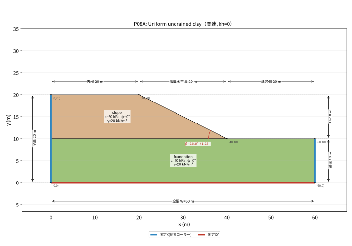

- 名称: Uniform undrained clay
- 目的: 均質非排水粘土（φ=0, Tresca相当）
- 文献/由来: R03 / nondimensional_literature_case_dimensionalized（出典箇所: Example4 Fig9; homogeneous limit also Example3）
- 外形（反時計回り, m）: `(0, 0) → (60, 0) → (60, 10) → (40, 10) → (20, 20) → (0, 20)`
- 面積: 900 m² ／ 総重量: 18000 kN/m ／ メッシュ目標h (M0/M1/M2): 2.5 / 1.25 / 0.625 m
- 流れ則: 関連（ψ=φ）（ψ政策 `equal_reduced_phi`）
- 水: なし ／ 地震: kh=0（なし） ／ 荷重: なし
- 境界: 底面 固定XY、左右鉛直端 固定X（鉛直ローラー）、その他 自由

| 材料 | E (kPa) | ν | γ (kN/m³) | c (kPa) | φ (°) | ψ (°) |
|---|---:|---:|---:|---:|---:|---:|
| slope | 100000 | 0.3 | 20 | 50 | 0 | 0 |
| foundation | 100000 | 0.3 | 20 | 50 | 0 | 0 |

参照Fs（文献の方法別報告値。本メッシュの保証値ではない）:

| 方法 | Fs | 出典 |
|---|---:|---|
| Taylor homogeneous comparison | 1.47 | R03 Examples3/4; not exact finite-mesh value |

補足仮定・制限（カタログ原文）:

- H=10 m, gamma=20; cu1/(gamma H)=0.25; total-stress Tresca represented as MC phi=psi=0.
- No pore-pressure degree of freedom is added; E=100000 kPa, nu=0.3 are explicit numerical choices.
- For ratio 0.6 and 1.5 no digitized graph value is invented; establish the mesh-specific golden by independent solvers.

### P09A

- 名称: Weak clay foundation
- 目的: 軟弱粘土基礎（基礎cu=30 < 斜面cu=50、保留評価群）
- 文献/由来: R03 / nondimensional_literature_case_dimensionalized（出典箇所: Example4 Fig9; homogeneous limit also Example3）
- 外形（反時計回り, m）: `(0, 0) → (60, 0) → (60, 10) → (40, 10) → (20, 20) → (0, 20)`
- 面積: 900 m² ／ 総重量: 18000 kN/m ／ メッシュ目標h (M0/M1/M2): 2.5 / 1.25 / 0.625 m
- 流れ則: 関連（ψ=φ）（ψ政策 `equal_reduced_phi`）
- 水: なし ／ 地震: kh=0（なし） ／ 荷重: なし
- 境界: 底面 固定XY、左右鉛直端 固定X（鉛直ローラー）、その他 自由

| 材料 | E (kPa) | ν | γ (kN/m³) | c (kPa) | φ (°) | ψ (°) |
|---|---:|---:|---:|---:|---:|---:|
| slope | 100000 | 0.3 | 20 | 50 | 0 | 0 |
| foundation | 100000 | 0.3 | 20 | 30 | 0 | 0 |

参照Fs: 記載なし（派生/診断入力のため元ケースの値をコピーしていない）

補足仮定・制限（カタログ原文）:

- H=10 m, gamma=20; cu1/(gamma H)=0.25; total-stress Tresca represented as MC phi=psi=0.
- No pore-pressure degree of freedom is added; E=100000 kPa, nu=0.3 are explicit numerical choices.
- For ratio 0.6 and 1.5 no digitized graph value is invented; establish the mesh-specific golden by independent solvers.

### P10A

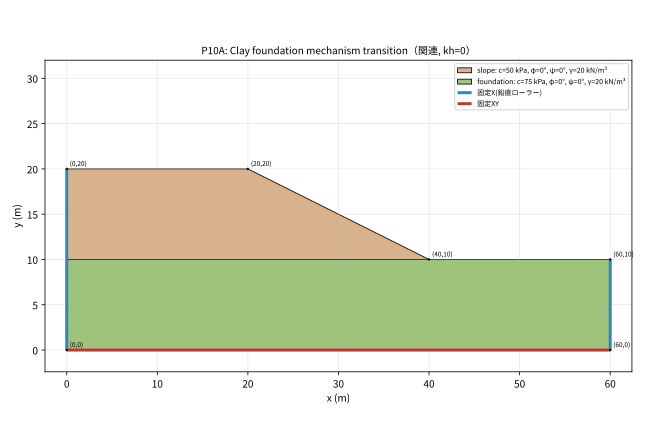

- 名称: Clay foundation mechanism transition
- 目的: 硬い粘土基礎（基礎cu=75）で破壊機構が変わる場合（保留評価群）
- 文献/由来: R03 / nondimensional_literature_case_dimensionalized（出典箇所: Example4 Fig9; homogeneous limit also Example3）
- 外形（反時計回り, m）: `(0, 0) → (60, 0) → (60, 10) → (40, 10) → (20, 20) → (0, 20)`
- 面積: 900 m² ／ 総重量: 18000 kN/m ／ メッシュ目標h (M0/M1/M2): 2.5 / 1.25 / 0.625 m
- 流れ則: 関連（ψ=φ）（ψ政策 `equal_reduced_phi`）
- 水: なし ／ 地震: kh=0（なし） ／ 荷重: なし
- 境界: 底面 固定XY、左右鉛直端 固定X（鉛直ローラー）、その他 自由

| 材料 | E (kPa) | ν | γ (kN/m³) | c (kPa) | φ (°) | ψ (°) |
|---|---:|---:|---:|---:|---:|---:|
| slope | 100000 | 0.3 | 20 | 50 | 0 | 0 |
| foundation | 100000 | 0.3 | 20 | 75 | 0 | 0 |

参照Fs: 記載なし（派生/診断入力のため元ケースの値をコピーしていない）

補足仮定・制限（カタログ原文）:

- H=10 m, gamma=20; cu1/(gamma H)=0.25; total-stress Tresca represented as MC phi=psi=0.
- No pore-pressure degree of freedom is added; E=100000 kPa, nu=0.3 are explicit numerical choices.
- For ratio 0.6 and 1.5 no digitized graph value is invented; establish the mesh-specific golden by independent solvers.

### D01A

- 名称: All c=0, 45 degree face, phi=30
- 目的: c=0・45°法面・φ=30°（上界の適格性検査群）
- 文献/由来: R02 / designed_diagnostic（出典箇所: p8 Fig3 Table1）
- 外形（反時計回り, m）: `(0, 0) → (20, 0) → (20, 4) → (16, 4) → (10, 10) → (0, 10)`
- 面積: 158 m² ／ 総重量: 3160 kN/m ／ メッシュ目標h (M0/M1/M2): 1.25 / 0.625 / 0.3125 m
- 流れ則: 関連（ψ=φ）（ψ政策 `equal_reduced_phi`）
- 水: なし ／ 地震: kh=0（なし） ／ 荷重: なし
- 境界: 底面 固定XY、左右鉛直端 固定X（鉛直ローラー）、その他 自由

| 材料 | E (kPa) | ν | γ (kN/m³) | c (kPa) | φ (°) | ψ (°) |
|---|---:|---:|---:|---:|---:|---:|
| soil | 14000 | 0.3 | 20 | 0 | 30 | 30 |

参照Fs: 記載なし（派生/診断入力のため元ケースの値をコピーしていない）

補足仮定・制限（カタログ原文）:

- R02 uses explicit large-deformation SPFEM; compare failure onset, not its 6 s final displacement.
- No explicit tensile cap was specified in the inspected benchmark description; this input adds none.
- Fs<1 must be allowed; the independent-gravity trial profile is an explicit static-FEM adaptation.

### D02A

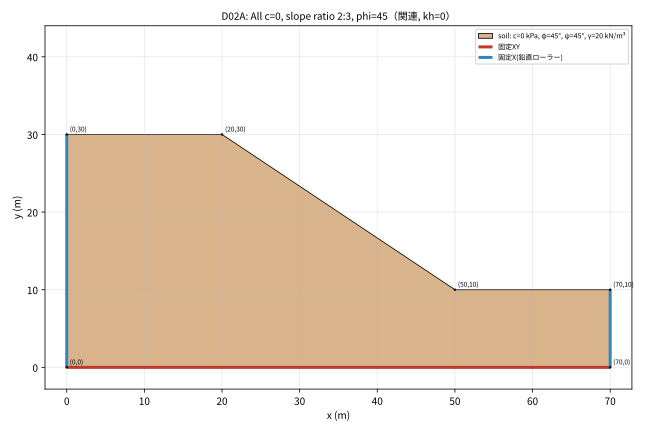

- 名称: All c=0, slope ratio 2:3, phi=45
- 目的: c=0・勾配2:3・φ=45°（表層滑り極限機構 tan45°/tan(arctan(2/3))=1.5 との照合）
- 文献/由来: 独自診断 / designed_diagnostic（出典箇所: 設計診断。文献再現ではない。）
- 外形（反時計回り, m）: `(0, 0) → (70, 0) → (70, 10) → (50, 10) → (20, 30) → (0, 30)`
- 面積: 1400 m² ／ 総重量: 28000 kN/m ／ メッシュ目標h (M0/M1/M2): 3.75 / 1.875 / 0.9375 m
- 流れ則: 関連（ψ=φ）（ψ政策 `equal_reduced_phi`）
- 水: なし ／ 地震: kh=0（なし） ／ 荷重: なし
- 境界: 底面 固定XY、左右鉛直端 固定X（鉛直ローラー）、その他 自由

| 材料 | E (kPa) | ν | γ (kN/m³) | c (kPa) | φ (°) | ψ (°) |
|---|---:|---:|---:|---:|---:|---:|
| soil | 30000 | 0.3 | 20 | 0 | 45 | 45 |

参照Fs: 記載なし（派生/診断入力のため元ケースの値をコピーしていない）

- tan45°/tan(arctan(2/3))=1.5は表層滑りの極限機構の照合値。有限メッシュのFs=1.5を保証するものではない。保存済みG1モデルを復元した入力でもない。
補足仮定・制限（カタログ原文）:

- Designed case, not reconstruction of the saved G1 workbook.

### D03N

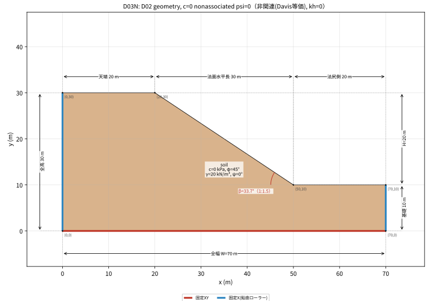

- 名称: D02 geometry, c=0 nonassociated psi=0
- 目的: D02と同形状の非関連（ψ=0）版（異常系/不変性）
- 文献/由来: 独自診断 / designed_diagnostic（出典箇所: 設計診断。文献再現ではない。）
- 外形（反時計回り, m）: `(0, 0) → (70, 0) → (70, 10) → (50, 10) → (20, 30) → (0, 30)`
- 面積: 1400 m² ／ 総重量: 28000 kN/m ／ メッシュ目標h (M0/M1/M2): 3.75 / 1.875 / 0.9375 m
- 流れ則: 非関連（Davis等価）（ψ政策 `hold_initial`）
- 水: なし ／ 地震: kh=0（なし） ／ 荷重: なし
- 境界: 底面 固定XY、左右鉛直端 固定X（鉛直ローラー）、その他 自由

| 材料 | E (kPa) | ν | γ (kN/m³) | c (kPa) | φ (°) | ψ (°) |
|---|---:|---:|---:|---:|---:|---:|
| soil | 30000 | 0.3 | 20 | 0 | 45 | 0 |

参照Fs: 記載なし（派生/診断入力のため元ケースの値をコピーしていない）

補足仮定・制限（カタログ原文）:

- Designed case, not reconstruction of the saved G1 workbook.

### D04A

- 名称: Elastic modulus sensitivity E/10
- 目的: 弾性係数E/10の感度（Eは剛塑性モデルの入力ではないが実際に実行する）
- 文献/由来: R02 / designed_diagnostic（出典箇所: p8 Fig3 Table1）
- 外形（反時計回り, m）: `(0, 0) → (20, 0) → (20, 4) → (16, 4) → (10, 10) → (0, 10)`
- 面積: 158 m² ／ 総重量: 3160 kN/m ／ メッシュ目標h (M0/M1/M2): 1.25 / 0.625 / 0.3125 m
- 流れ則: 関連（ψ=φ）（ψ政策 `equal_reduced_phi`）
- 水: なし ／ 地震: kh=0（なし） ／ 荷重: なし
- 境界: 底面 固定XY、左右鉛直端 固定X（鉛直ローラー）、その他 自由

| 材料 | E (kPa) | ν | γ (kN/m³) | c (kPa) | φ (°) | ψ (°) |
|---|---:|---:|---:|---:|---:|---:|
| soil | 1400 | 0.3 | 20 | 10 | 25 | 25 |

参照Fs: 記載なし（派生/診断入力のため元ケースの値をコピーしていない）

補足仮定・制限（カタログ原文）:

- R02 uses explicit large-deformation SPFEM; compare failure onset, not its 6 s final displacement.
- No explicit tensile cap was specified in the inspected benchmark description; this input adds none.
- Fs<1 must be allowed; the independent-gravity trial profile is an explicit static-FEM adaptation.

### D05A

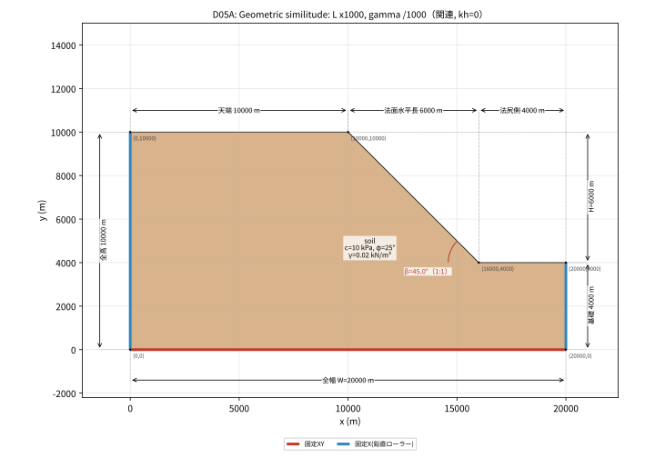

- 名称: Geometric similitude: L x1000, gamma /1000
- 目的: 幾何相似（長さ×1000, γ/1000）。理想FsはP02Aと同じ
- 文献/由来: R02 / designed_diagnostic（出典箇所: p8 Fig3 Table1）
- 外形（反時計回り, m）: `(0, 0) → (20000, 0) → (20000, 4000) → (16000, 4000) → (10000, 10000) → (0, 10000)`
- 面積: 1.58e+08 m² ／ 総重量: 3.16e+06 kN/m ／ メッシュ目標h (M0/M1/M2): 1250 / 625 / 312.5 m
- 流れ則: 関連（ψ=φ）（ψ政策 `equal_reduced_phi`）
- 水: なし ／ 地震: kh=0（なし） ／ 荷重: なし
- 境界: 底面 固定XY、左右鉛直端 固定X（鉛直ローラー）、その他 自由

| 材料 | E (kPa) | ν | γ (kN/m³) | c (kPa) | φ (°) | ψ (°) |
|---|---:|---:|---:|---:|---:|---:|
| soil | 14000 | 0.3 | 0.02 | 10 | 25 | 25 |

参照Fs: 記載なし（派生/診断入力のため元ケースの値をコピーしていない）

- 不変性試験: same ideal Fs as P02A; displacements divided by length should match under same discretization
補足仮定・制限（カタログ原文）:

- R02 uses explicit large-deformation SPFEM; compare failure onset, not its 6 s final displacement.
- No explicit tensile cap was specified in the inspected benchmark description; this input adds none.
- Fs<1 must be allowed; the independent-gravity trial profile is an explicit static-FEM adaptation.

### D06A

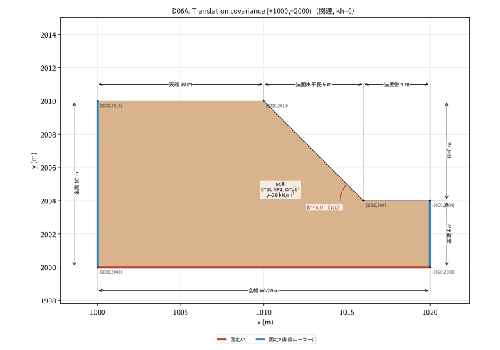

- 名称: Translation covariance (+1000,+2000)
- 目的: 平行移動（+1000,+2000）。FsはP02Aと同じはず
- 文献/由来: R02 / designed_diagnostic（出典箇所: p8 Fig3 Table1）
- 外形（反時計回り, m）: `(1000, 2000) → (1020, 2000) → (1020, 2004) → (1016, 2004) → (1010, 2010) → (1000, 2010)`
- 面積: 158 m² ／ 総重量: 3160 kN/m ／ メッシュ目標h (M0/M1/M2): 1.25 / 0.625 / 0.3125 m
- 流れ則: 関連（ψ=φ）（ψ政策 `equal_reduced_phi`）
- 水: なし ／ 地震: kh=0（なし） ／ 荷重: なし
- 境界: 底面 固定XY、左右鉛直端 固定X（鉛直ローラー）、その他 自由

| 材料 | E (kPa) | ν | γ (kN/m³) | c (kPa) | φ (°) | ψ (°) |
|---|---:|---:|---:|---:|---:|---:|
| soil | 14000 | 0.3 | 20 | 10 | 25 | 25 |

参照Fs: 記載なし（派生/診断入力のため元ケースの値をコピーしていない）

- 不変性試験: same Fs and displacement field translated back as P02A
補足仮定・制限（カタログ原文）:

- R02 uses explicit large-deformation SPFEM; compare failure onset, not its 6 s final displacement.
- No explicit tensile cap was specified in the inspected benchmark description; this input adds none.
- Fs<1 must be allowed; the independent-gravity trial profile is an explicit static-FEM adaptation.

### D07A

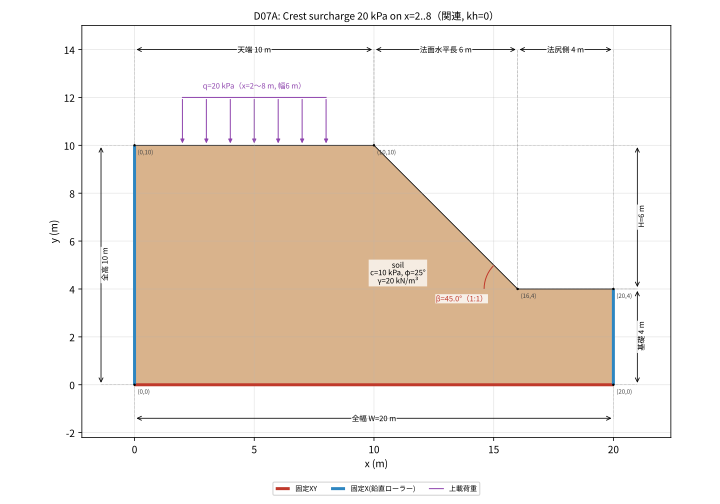

- 名称: Crest surcharge 20 kPa on x=2..8
- 目的: 天端上載荷重20 kPa（x=2〜8）
- 文献/由来: R02 / designed_diagnostic（出典箇所: p8 Fig3 Table1）
- 外形（反時計回り, m）: `(0, 0) → (20, 0) → (20, 4) → (16, 4) → (10, 10) → (0, 10)`
- 面積: 158 m² ／ 総重量: 3160 kN/m ／ メッシュ目標h (M0/M1/M2): 1.25 / 0.625 / 0.3125 m
- 流れ則: 関連（ψ=φ）（ψ政策 `equal_reduced_phi`）
- 水: なし ／ 地震: kh=0（なし） ／ 荷重: 天端 20 kPa（x=2〜8）
- 境界: 底面 固定XY、左右鉛直端 固定X（鉛直ローラー）、その他 自由

| 材料 | E (kPa) | ν | γ (kN/m³) | c (kPa) | φ (°) | ψ (°) |
|---|---:|---:|---:|---:|---:|---:|
| soil | 14000 | 0.3 | 20 | 10 | 25 | 25 |

参照Fs: 記載なし（派生/診断入力のため元ケースの値をコピーしていない）

- 追加荷重: `[{"type": "uniform_boundary_traction", "a": [2, 10], "b": [8, 10], "traction_kPa": [0, -20]}]`
補足仮定・制限（カタログ原文）:

- R02 uses explicit large-deformation SPFEM; compare failure onset, not its 6 s final displacement.
- No explicit tensile cap was specified in the inspected benchmark description; this input adds none.
- Fs<1 must be allowed; the independent-gravity trial profile is an explicit static-FEM adaptation.

### D08A

- 名称: Fixed pore pressure field, water elevation y=3
- 目的: 固定静水圧間隙水圧場（水位y=3）
- 文献/由来: R02 / designed_diagnostic（出典箇所: p8 Fig3 Table1）
- 外形（反時計回り, m）: `(0, 0) → (20, 0) → (20, 4) → (16, 4) → (10, 10) → (0, 10)`
- 面積: 158 m² ／ 総重量: 3160 kN/m ／ メッシュ目標h (M0/M1/M2): 1.25 / 0.625 / 0.3125 m
- 流れ則: 関連（ψ=φ）（ψ政策 `equal_reduced_phi`）
- 水: 静水圧 水位y=3 m ／ 地震: kh=0（なし） ／ 荷重: なし
- 境界: 底面 固定XY、左右鉛直端 固定X（鉛直ローラー）、その他 自由

| 材料 | E (kPa) | ν | γ (kN/m³) | c (kPa) | φ (°) | ψ (°) |
|---|---:|---:|---:|---:|---:|---:|
| soil | 14000 | 0.3 | 20 | 10 | 25 | 25 |

参照Fs: 記載なし（派生/診断入力のため元ケースの値をコピーしていない）

- 間隙水圧: `{"mode": "fixed_hydrostatic", "water_elevation_m": 3.0, "gamma_w_kPa_m": 9.81, "formula": "9.81*max(3-y,0)", "surface_water_traction": "none; exposed ground is above y=3"}`
補足仮定・制限（カタログ原文）:

- R02 uses explicit large-deformation SPFEM; compare failure onset, not its 6 s final displacement.
- No explicit tensile cap was specified in the inspected benchmark description; this input adds none.
- Fs<1 must be allowed; the independent-gravity trial profile is an explicit static-FEM adaptation.

### D09A

- 名称: Near-incompressibility diagnostic nu=0.49
- 目的: ほぼ非圧縮 ν=0.49（νは剛塑性モデルの入力ではないが実際に実行する）
- 文献/由来: R02 / designed_diagnostic（出典箇所: p8 Fig3 Table1）
- 外形（反時計回り, m）: `(0, 0) → (20, 0) → (20, 4) → (16, 4) → (10, 10) → (0, 10)`
- 面積: 158 m² ／ 総重量: 3160 kN/m ／ メッシュ目標h (M0/M1/M2): 1.25 / 0.625 / 0.3125 m
- 流れ則: 関連（ψ=φ）（ψ政策 `equal_reduced_phi`）
- 水: なし ／ 地震: kh=0（なし） ／ 荷重: なし
- 境界: 底面 固定XY、左右鉛直端 固定X（鉛直ローラー）、その他 自由

| 材料 | E (kPa) | ν | γ (kN/m³) | c (kPa) | φ (°) | ψ (°) |
|---|---:|---:|---:|---:|---:|---:|
| soil | 14000 | 0.49 | 20 | 10 | 25 | 25 |

参照Fs: 記載なし（派生/診断入力のため元ケースの値をコピーしていない）

補足仮定・制限（カタログ原文）:

- R02 uses explicit large-deformation SPFEM; compare failure onset, not its 6 s final displacement.
- No explicit tensile cap was specified in the inspected benchmark description; this input adds none.
- Fs<1 must be allowed; the independent-gravity trial profile is an explicit static-FEM adaptation.

## 不明・記載なし

- R02/R03/R10/R11 の正式な書誌情報（著者・誌名・年・DOI）。
- A ケースと D ケースの参照Fs（D02A の 1.5 は極限機構の照合値で、有限メッシュの保証値ではない）。P03N の文献 Case3 の土質定数の出典表記以外の詳細。
- 各ケースの「目標精度」はケース定義には含まれない（ベンチマークの設定 GAP による）。
- 入力JSON内の `settings`（CYCLES など）は G1R17 の計測プロファイルの値で、各版の製品設定とは異なる場合がある。

再生成: リポジトリ直下で `python docs/validation_cases/tools/plot_cases.py && python docs/validation_cases/tools/gen_readme.py`（matplotlib と日本語フォント Noto Sans CJK JP 等が必要）。
