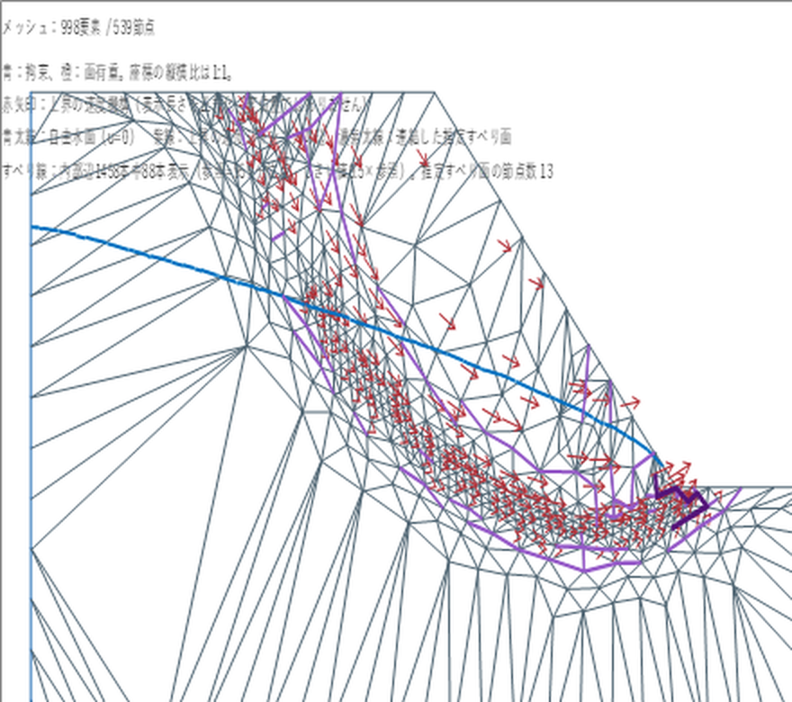
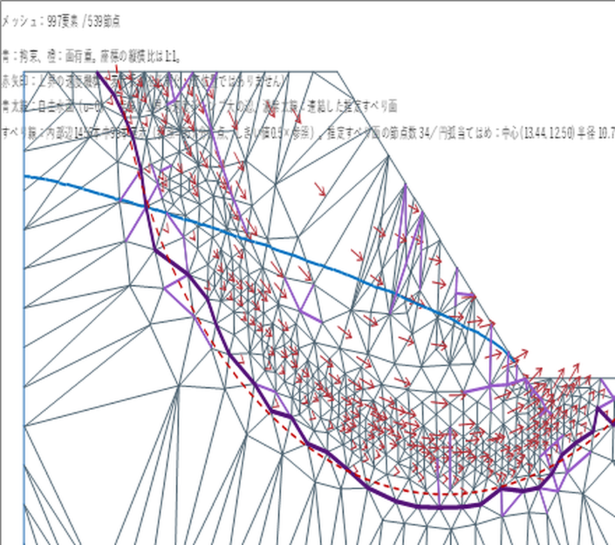

# 浸透流解析・極限解析 一方向連成 手順書

## 1. 概要
既存の極限解析ツール（上下界でFSを挟み込む剛塑性FEM）に、次の機能を追加します。
- 定常浸透流解析：線形三角形要素（T3）、材料ごとの異方性透水係数 kx・ky、不圧（自由水面）。
- 一方向連成：浸透解析で求めた間隙水圧を、有効応力として下界・上界の両方のFS探索に反映します。
- 図の重ね描き：自由水面、速度ジャンプの大きい辺（推定すべり線）、連続した推定すべり面と当てはめた円弧。

| モジュール | 役割 |
|---|---|
| RPX_Seep | 浸透ソルバー（RCM並べ替え＋帯状行列のCholesky分解、kr低減によるPicard反復、浸出面の切り替え） |
| RPX_SeepUI | 浸透入力シート、形状定義からのメッシュ生成と境界の自動割当、図の重ね描き、自己テスト |
| RPX_Water | 連成処理（水頭の補間、体積力 −∇u の付加） |
| RPX_CouplingInstall | フック行の自動挿入（任意。制約は3章を参照） |

## 2. 導入（元のブックへ）
1. ブックのバックアップを取ります。
2. 旧版の RPX_Seep / RPX_SeepUI / RPX_Water が入っている場合は、VBEで右クリック →「解放」（エクスポートは不要）で削除します。
3. **一度保存してブックを閉じ、開き直します。** 同名のモジュールを削除した直後にインポートすると、「RPX_Seep1」のような別名で取り込まれることがあります。
4. VBEの「ファイル → ファイルのインポート」で、次のファイルを取り込みます。
   `RPX_Seep_cp932.bas`、`RPX_SeepUI_cp932.bas`、`RPX_Water_cp932.bas`
5. 既存コードにフック行を2行加えます（3章）。
6. 「デバッグ → VBAProject のコンパイル」でエラーが出ないことを確認し、保存します。
7. イミディエイトウィンドウで `RPX_SeepSetupSheet` を実行し、「浸透入力」シートを作ります。
8. 動作確認として、イミディエイトウィンドウで次を実行します。
   - `?RPX_SeepTestDam(40,20)` → Q が 2.418 前後
   - `?RPX_SeepOverlaySelfTest` → ケース4が「合格」

PowerShell スクリプト `install_into_workbook.ps1` を使うと、2〜7を自動で行います。前提として、Excel のトラスト センターで「VBA プロジェクト オブジェクト モデルへのアクセスを信頼する」をオンにしてください。

```
powershell -ExecutionPolicy Bypass -File install_into_workbook.ps1 -Workbook "C:\path\tool.xlsm"
```

## 3. フック行（既存コードへの変更はこの2行だけ）
| ID | モジュール.プロシージャ | この行の直後に | 追加する行 |
|---|---|---|---|
| E1 | RPX_Mesh.RPX_AssignRegions | `RPX_LoadPhase = "raw"` | `    Call RPX_WaterApply` |
| E2 | RPX_Control.RPX_DrawCore | `If RPX_ResultCurrent Then Call RPX_DrawVelocity` | `    Call RPX_SeepOverlay` |

注意：`RPX_CouplingInstall` を同じブックの中から Application.Run で呼んでも、実行中のプロジェクト自身のコードは書き換えられません。VBEで手作業で入力するか、PowerShell スクリプトを使ってください。

## 4. 浸透入力シート
- **A:C 透水係数**：材料ID（「材料データ」と同じID）、kx [m/s]、ky [m/s]。ky が空欄なら kx と同じにします。剛体の領域は、設定 N14 の比率 × 最大の透水係数で扱います。
- **E:K 水理境界**：境界ID、領域ID、開始点、終了点、循環（0/1）、種別、値。経路のたどり方は「要素定義」の面条件と同じで、領域の定義順に開始点から終了点まで進みます。

| 種別 | 意味（値） |
|---|---|
| 水頭 | 全水頭を固定（値 [m]） |
| 水位 | 標高が値以下の節点は水頭＝値、それより上は不透水 |
| 水位+浸出面 | 標高が値以下の節点は水頭＝値、それより上は浸出面 |
| 浸出面 | 浸出面（水頭＝標高の条件を自動で切り替え） |
| 流量 | 単位長さ当たりの流入量 [m3/s/m]（流入を＋） |
| 不透水 | 不透水（指定のない境界も不透水） |

- **N7〜N23 設定**

| セル | 項目 | 既定値 |
|---|---|---|
| N7 | 目標要素数（0のときは「設定」シートの TARGET） | 0 |
| N8 | krmin（透水係数比の下限） | 1e-4 |
| N9 | β [1/m]（kr = exp(β×圧力水頭)） | 20 |
| N10 | 緩和係数 | 0.5 |
| N11 | 収束判定 [m] | 1e-6 |
| N12 | 最大反復回数 | 300 |
| N13 | γw [kN/m3] | 9.81 |
| N14 | 剛体の透水係数比 | 1e-6 |
| N15 | 自由水面を描画（1/0） | 1 |
| N16 | すべり線のしきい値（参照値に対する倍率） | 0.5 |
| N17 | ひずみ速度を描画（1/0） | 0 |
| N18 | ひずみ速度のしきい値 | 0.2 |
| N19 | **連成する**（1/0） | 0 |
| N20 | サクションを考慮（0：u<0 は 0 とする） | 0 |
| N21 | すべり線の参照分位点 | 0.95 |
| N22 | すべり線の最大表示割合 | 0.1 |
| N23 | 円弧当てはめ（1/0） | 1 |

## 5. 解析の流れ
1. 「浸透入力」シートを入力し、「浸透解析」ボタンを押します。結果は「浸透結果」シート（節点の h・u・流量、自由水面、要素表、計算ID）と「図」シートに出ます。
2. 連成する場合は N19 を 1 にしてから、「要素定義」シートの「解析」を実行します。N19 を切り替えたり、浸透条件を変えたりした後は、必ず解析し直してください。
3. 「図を表示」で、自由水面（青の太線）、速度ジャンプの大きい辺（明るい紫）、推定すべり面（濃い紫の太線）、当てはめた円弧（赤の破線。中心と半径は A5 に表示）を描きます。
4. 上界の速度場はブックを開き直すと失われます。すべり線を表示するには、もう一度解析してください（自由水面は「浸透結果」シートから描き直せます）。
5. 材料データの γ には全重量を入力してください（地下水位より下は飽和単位体積重量）。

## 6. 理論の要点
- 応力変数は有効応力 σ'（引張を正）として扱います。全応力は σ = σ' − u I です。
- つり合い式は div σ' + (b − ∇u) = 0 です。浸透メッシュの節点水頭を極限解析メッシュの節点へ線形補間し、u = γw·max(h − y, 0) を求め、要素ごとの体積力に −∇u（要素内で一定）を加えます。
- 境界の水圧荷重は加えません。−∇u の体積積分は −∮u n ds に等しく、外水圧の合力をすでに含んでいるため、加えると二重に数えることになります。水頭を固定した境界では u が外水圧と等しく、σ'n は利用者が入力した荷重と等しくなります。
- 強度低減法の FS は「λ = 1 で崩壊する強度の低減率」です。水圧を固定荷重に置いても比例荷重に置いても λ = 1 での問題は同じなので、FS は変わりません。既存の RPX_TotalReferenceLoads は変更していません。
- 体積力は重力と水圧から毎回作り直すので、何度呼ばれても同じ結果になります。N19 = 0 のときは何もしません。

## 7. 検証結果
| 項目 | 結果 |
|---|---|
| 長方形の均質ダム（L=20, H1=10, H2=2, 40×20） | Q = 2.4181（Dupuit 式 2.400 に対し +0.75%）。浸出点は低めに出る |
| 全没水の連成（A）と浮力を差し引いた重量（B） | FS は A・B とも 2.0655 / 2.0957 で完全に一致 |
| 実モデル（998要素）：連成なし | FS 1.152 / 1.171 |
| 実モデル：連成あり | FS 1.110 / 1.127（約 −4%） |
| 推定すべり面 | 34節点、円弧の中心 (13.44, 12.50)、半径 R = 10.77 m |

連成なしの図：



連成ありの図：



## 8. 既知の制限
- 浸出点は、kr を滑らかに下げる方式の影響で低めに出ます。流量への影響は 1% 未満です。
- 推定すべり面はメッシュの辺をたどる階段状の線なので、当てはめた円弧の半径はやや小さめに出ます。
- 水面下にある剛体要素には水圧をかけていません。
- 適応メッシュでの解析には約20〜25分かかります。
- 外部プログラムから COM の Application.Run で長時間の解析を起動したとき、DISP_E_EXCEPTION が一度出たことがあります（解析自体は完了していました）。Excel のボタンから実行することを推奨します。追跡ログは %TEMP%\rpx_seep_trace.log に残ります。
