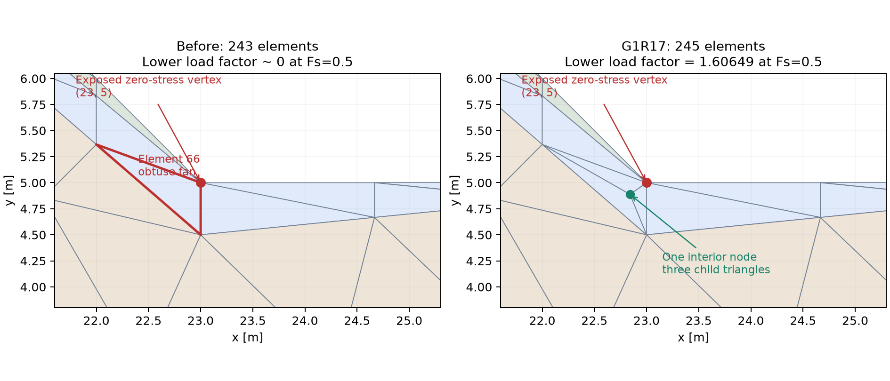

# G1R17 P06A・P06N 粗メッシュ修復報告

**追加試験（2026-10-13）：同じG1R17で間隙水圧を含む26ケースのFs探索・適応解析を実行しました。独立監査済みFs取得26/26、精度目標達成10/26。[図入り実測報告・CSV・証拠ZIP](../../docs/benchmarks/G1R17_native26_20261013/README.md)。以下は10月12日の局所修復の検証記録です。**

2026-10-12。G1R16 DLL5（基準commit `83debbecdc5f6376988aa1d93ebf1e6ecddf7477`）を基に、VBAとDLLの両方を修正しました。P06Nに加え、P06Aでも同じ粗メッシュ制約が発生することを確認し、両ケースでFs上下界を取得しています。この局所修復の試験時点では、フル適応解析は未実施でした。

## 結果

|ケース|Fs下界|Fs上界|上下界幅 / 上界|時間・同一PC各1回|終端判定|
|---|---:|---:|---:|---:|---|
|P06N・Davis等価|0.56014867986871|0.88211706228386|36.50%|334.74秒|PARTIAL_CERTIFIED|
|P06A・関連|0.73110643495835|1.02853737684000|28.92%|330.82秒|PARTIAL_CERTIFIED|

TARGET200、実際245要素・147節点、q8、ADAPT0、浸透OFF、kh0。Fsの未取得は解消しましたが、上下界区間の目標精度には未達です。この粗メッシュ区間から単一の高精度Fsを確定できません。表の時間は今回の粗メッシュ確認の所要時間で、G1R16比の高速化実績を示すものではありません。

## 原因を特定した証拠

元の243要素・146節点のP06Nでは、下界の各求解自体は`OPTIMAL`となりながら、荷重倍率λがほぼ0でした。Fsを下げ続けてもλが1を超えず、`FS_LOWER_BRACKET_NOT_FOUND`で終わっています。ログの下界`objective`は **−λ** です。λが負だった、あるいはHSDが停止していたという意味ではありません。

P06Aも元メッシュ・Fs=0.5の実Excel固定点で、λ=1.07400023240042e−10、20反復、物理監査PASSを確認しました。P06Aの旧版については、この固定点と独立証明で確認し、旧版の全Fs探索は再実行していません。

保存済み実メッシュをPythonへ移し、同じMC・Davis政策・Fs・重力・境界荷重で別のSOCPを組み立てました。実Excelから出力した下界SOCP係数との比較は、元/修復メッシュ×P06A/Nの4組すべて一致し、最大差は4.44e−16です。入力再構成やDLL固有の演算差による問題を除外しました。

さらに真のSOCより緩い8面外接多角形LPで、最大λ≤0の数値双対証明を得ました。双対の定常性残差は約1e−14、非負重みを確認しています。等式だけではλ=1が可能でした。局所化すると、作用する制約はc=0弱層の3三角形（Excel要素19・52・66）に集中しました。これは有限メッシュの数値証拠であり、連続体の物理的Fsが0という結論ではありません。

斜面の折れ点(23,5)にあるc=0の自由頂点はゼロ応力です。そのゼロ応力がc=0同士の辺を通じて隣の要素へ伝わり、自由辺を直接持たない**要素66の鈍角頂点ファン**にも到達します。この形状とBernstein応力係数の降伏制約・重力釣合いが組み合わさり、粗メッシュの下界許容場から正の荷重倍率が失われていました。既存の「自由辺が2本ある要素」の修復は、この隣接要素を扱っていませんでした。

[元P06Nログ](results/original_P06N_DLL5_logs/) / [元P06A固定点](results/original_P06A_fixed/summary.json) / [局所化証拠](results/localization.json) / [P06A/N独立比較](results/paired_python.json) / [実組立係数との照合](results/assembled_python_comparison.json)。

## VBA・DLLの修正

Pythonで局所分割・辺反転を先に比較しました。要素66の1要素だけを内部点で3分割すると、正の下界荷重倍率が回復しました。製品では要素番号を指定せず、次の一般条件で判定します。

1. 土要素でcが厳密に0、無荷重の自由境界からゼロ応力頂点が接続している。
2. 接続はc=0同士の共有辺を通る。離れた材料の同じ節点番号を一括マークしない。
3. 原荷重の物体力が非ゼロで、露出頂点の角が90度を明確に超える。
4. 角の二等分線上の厳密な内部点を追加し、元三角形を3分割する。露出頂点に接する子要素を鋭角にし、繰返し分割を避ける。

P06A/Nとも追加は1節点・2要素だけです。全領域面積302.5 m²、3材料の面積83.75/11.6/207.15 m²、単位奥行当たり重量5747.5 kN/m、境界・材料界面・元節点を維持しました。単なる求解許容差の緩和、cへの微小正値の追加、監査省略、極小Fsの打切りではありません。

VBAでは`RPX_Mesh`を修正し、`RPX_NativeMesh`を追加しました。DLLでは`rpfem_meshfan.cpp`に、入力の複製・自由頂点伝播・角度判定・分割位置計画を実装しました。20ms単位でVBAへ戻り、`DoEvents`と入力検査を保ちます。原メッシュやVBAポインタをDLLへ保持せず、計画結果の取得・容量と入力の再確認後にVBAが変更を反映します。

全追加容量を変更前に検査します。中断18、メモリ不足7、添字9、未知例外513、入力不一致5を伝播し、通常の再メッシュ失敗として隠しません。DLL文脈は成功・中断・例外時に解放します。実C++割当11箇所のメモリ不足と4箇所の未知例外、100回の途中解放も確認しました。

DLL5のLDL・DD・NT・HSD・Schur・疎構造・MC・Davis・Fs政策・物理監査・許容差は維持しました。ABIはG1R17用`0x00170005`、DLL名は従来どおり`rpfem_native_x64.dll`です。旧DLL・DLLなしでは同じ修復を持つVBAへ復帰します。

## 精度・ロバスト性の検証

|検証|実行結果|
|---|---|
|実Excel粗メッシュP06N / P06A|22 / 21求解完了、230 / 214監査すべてPASS|
|保存済み全応力場・速度場のPython監査|両ケース・両上下界PASS|
|PythonとのFs根区間照合|両ケースの上下界端点の符号・可行側を確認|
|固定FsのVBA vs G1R17 DLL|P06N Fs0.5、P06A Fs0.7、全応力場とメッシュがビット単位で一致|
|VBA修復試作＋旧DLL5 vs G1R17|P06N粗メッシュの22求解・230監査が全記録一致。固定Fs全応力場も一致|
|25ケースのメッシュ生成|75回の実Excel出力。P06A/Nだけ各2要素増、他23ケースは元メッシュのまま。VBA/DLL全メッシュ・荷重がビット一致|
|失敗注入|実Excel13項目、C++割当11箇所＋未知例外4箇所、DLL文脈解放PASS|
|DLLなし / 旧DLL|実Excelで同じメッシュ、HSDのVBA復帰PASS|
|HSD解析的SOCP|LDL_CHECKED/PIVOT_ONLY計6条件、VBA/DLL出力がビット一致|
|NT|188入力、成功165入力がビット一致、例外分類の差0|
|既存DD / HSD-DD / 疎構造のDLL回帰|7552演算、80桁検査60組、疎構造120組PASS|
|配布ブック|2冊とも71モジュール。再読込・全プロジェクトコンパイル・ボタン・DLL_READY確認|
|原本保全|旧2,789ファイル＋旧P2-Sの32ファイルのハッシュ一致|

68個の既存モジュール、document moduleとイベント配置を変更していません。今回追加した試験用モジュール・注入フックを配布ブックに含めていません。インポート用3ファイルはCP932・CRLFの損失なしを確認しました。

## Python結果の扱いと限界

独立SOCPは[Clarabelの標準形](https://clarabel.org/stable/python/getting_started_py/)に合わせ、別コードの物理監査を追加しました。異なるソルバー同士の非一意な全場をビット比較せず、同じメッシュ・目的値・可行性・双対残差・物理場を照合しています。

P06N Fs0.5では、VBA/DLL λ=1.60649268863698に対し、Pythonは1.60648515668426、差7.53e−6です。Pythonは`AlmostSolved`、双対ギャップ4.30e−5で、完全収束とは記載しません。P06A Fs0.7では差7.16e−7、Pythonの双対ギャップ3.71e−6です。この2固定点のPython場・実Excel場は独立物理監査を通りました。

下界Fs根の可行端点では、Pythonでλ=1の監査済み場を確認しました。P06Aの反対端点Fs0.731162975511205は、最初の不可行証明の絶対残差7.15e−7が検査基準に届きませんでした。追加の最大荷重求解で、双対側の上限λ=0.999792271219107、定常性残差4.24e−10、SOC双対違反0を確認し、根区間との整合を検査しました。その追加求解の主変数場は平衡監査7.09e−7で不合格のまま記録し、出力場へ採用していません。VBA/DLLの監査基準は変えていません。

Pythonの等式削減試行や正則化を小さくする試行には`NumericalError`もありました。それらを合格数に含めず、[比較記録](results/fixed_python_comparison.json)、[正則化試行](results/python_regularization_trials.json)、[根端点検査](results/coarse_python_verification.json)に保存しました。試験ハーネスでは界面側0/1の遭遇順、入力監視の開始、添字注入位置を修正して再実行しました。失敗ログを保持し、同じDLLハッシュで取得済み実Excel出力を照合しています。

この局所修復試験ではフル適応P06A/P06N、25/26ケースのFs全解析、浸透連成の全解析、32bit実Excel、堤防例題の速度再測定は未実施でした。その後の26ケース試験ではフル適応P06A/P06Nと固定静水圧D08Aを含めて実行しました。32bit実Excelと反復浸透FEMの追加検証は、その試験の対象にも含めていません。局所修復はこの粗メッシュの不具合を解消しますが、あらゆる別形状・別メッシュでのFs取得や目標精度達成を保証するものではありません。

[試験台帳](TEST_RESULTS.csv) / [再現手順](REPRODUCTION_JA.md) / [導入・復旧](IMPORT_ROLLBACK_JA.md) / [ソース差分](changes.diff) / [DLL差分](native_changes.diff)。
