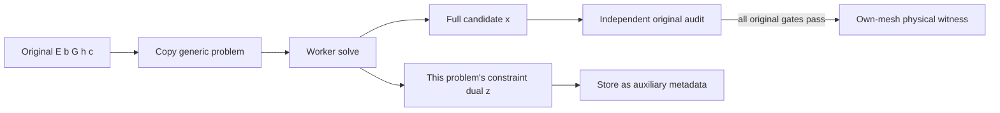

# G1R18 asynchronous accuracy DLL

`rpfem_accuracy_x64.dll` is a separate Windows x64 DLL using **Clarabel 0.11.1**
(exact Cargo version and checked-in lockfile). It does not replace the existing
RPFEM DLL and does not declare P06A/P06N complete. At the delivery transition,
the independently audited P06A pair was 0.8468–0.85755, relative width 1.2615%;
P06 remains an accuracy issue. The new solver is an optional candidate recovery
backend; acceptance remains in the original VBA/Python physical audits.

## Build

Run `build.ps1` from PowerShell. Its defaults use the isolated Rust installation
in `D:/Work/rpfem-rust-bootstrap/{cargo,rustup}`; override `-CargoHome` and
`-RustupHome` for another installation. Rust 1.85.0 and Visual Studio 2022 MSVC
Build Tools 14.44.35207 built the initial DLL. Rust discovers the installed
MSVC/Windows SDK locally; the script restores process environment changes and
does not modify system PATH, HOME or other installed Rust environments.

The script runs locked Windows x64 release build and Rust tests, then copies the
DLL to `bin/rpfem_accuracy_x64.dll` and verifies the copy's SHA256. The checked-in
Cargo configuration uses a static CRT and `/Brepro`; Visual C++ runtime
installation is not required by this DLL. `bin/build_manifest.json` records
toolchain, target and source/binary SHA256. Independent ctypes and original-model
numerical tests are in `../../tests/test_accuracy_native_ffi.py`.

From the repository root, with NumPy, SciPy and Clarabel 0.11.1 installed, run
`python -m unittest discover -s versions/G1R18/tests -p test_accuracy_native_ffi.py -v`.
The delivered DLL passed four Rust tests and 17 independent FFI tests, including
actual original q8 cohesive/nonzero-h and c=0 wedge witnesses. The copied
source/binary/model freeze evidence and PE import inspection are in `validation/`.
LSMR comparisons require equal solutions and true residuals; diagnostic condition
estimates and iteration counts can differ from SciPy due to stable norm rounding.

## Mathematical contract

The generic solver receives **owned copies** of finite CSR `A`, `b`, nonnegative
diagonal `P`, `q` and a product cone, and solves

```text
minimize  1/2 x' P x + q' x
subject to A x + s = b,  s in K.
```

CSR is zero-based, sorted within each row, without duplicate column indices.
The input pointers need remain valid only during `create`; no VBA borrowed
pointer survives that call. Zero, nonnegative and three-dimensional SOC blocks
are supported. The sum of cone dimensions must equal the matrix row count.

The original RPFEM sign convention and its equivalent generic form are:

```text
RPFEM:              E x = bE,        G x + h in K
Generic:        A = [ E ],      b = [ bE ],      Kgeneric = Zero x K
                   [-G ]           [ h  ]
Original dual:      c + E' y - G' z = 0, z in K*,
                   original objective = -bE' y - h' z.
```

For the same-space minimum-change QP, set `Pdiag=alpha`, `q=-alpha*center`.
An upper objective cap `c'x<=0.999998` adds a nonnegative block with
`Arow=c'`, `brow=0.999998`. A lower auxiliary load floor `lambda>=1.000003`
adds `Arow=-e_lambda'`, `brow=-1.000003`. These are search constraints; the
original lower witness threshold remains **1.000001**, the upper threshold
**0.999999**, and original physical tolerance **1e-7**. Reassemble and audit the
unchanged original problem before publishing a candidate.

For an original-dual feasibility helper, the helper **solution.x** contains the
proposed original `(y,z)`. Independently restore and check stationarity, original
dual cones and original objective using the original program. The helper
**solution.z** is the helper constraint dual and is not an original root guide.
The same restriction applies to every capped/floored/proximal QP constraint dual.



`Solved`, infeasibility statuses and all other solver states are metadata.
They cannot establish a physical bound or a discrete root. For non-unique
problems, compare original objectives and original residuals with Python,
rather than demanding bitwise equality of the full fields.

## ABI and lifecycle

The exact C declarations and byte offsets are in `rpfem_accuracy.h`.
ABI version is 1. Problem/settings/progress structures are 88/128/80 bytes on
Windows x64; explicitly packed VBA byte buffers avoid UDT alignment ambiguity.
Matrix dimensions and CSR indices are 32-bit. Handles are opaque unsigned
64-bit registry tokens, not borrowed pointers.

```text
default_settings -> create(COPY) -> start -> poll / Excel DoEvents
                                  |              |
                                  +-- cancel ----+
                   completed -> result(exact n,m buffers) -> destroy
```

Polling does not wait for the worker. Cancellation is checked before solver
construction and in the Clarabel iteration callback. A currently running sparse
factorization can finish before its next callback. Calling `destroy` while the
worker is running requests cancellation and returns `RPA_BUSY`; keep polling
with DoEvents, then destroy once completion is observed. Destruction joins only
an already finished worker and never blocks a running solve.

Result arrays must have exactly `n` and `m` entries, be properly aligned and
non-overlapping with one another or the progress structure. Only finite full
arrays are copied. The returned `z` always belongs to the generic problem
actually supplied. The result is a candidate even when the solver status is
infeasible, time-limited or numerically unsuccessful. After cancellation, a
finite saved candidate may be available, but it remains unaudited; the caller
must preserve its existing accepted witnesses until a fresh audit succeeds.

The registry rejects unknown handles and repeated destruction. Input guards
reject nonfinite arrays, negative diagonal P, malformed CSR, unsupported cones,
nonpositive/nonfinite budgets and size overflows. Hard limits are n<=2,000,000,
m<=8,000,000, nnz<=50,000,000, 64 owned handles and 8 simultaneous workers.
Each worker accepts 1–8 threads; the coordinator controls the combined resource
budget. All FFI entry points and worker execution catch Rust panics. As with
ordinary C APIs, nonnull pointers must reference the declared valid allocations;
pointer ownership and allocation validity remain the caller's contract.

The default solver settings use the successfully tested Python proximal profile:
350 iterations, 600 seconds, one thread, equilibration off, tolerances 1e-13,
and 30 refinement iterations at 1e-15. These solver options do not change the
independent original physical tolerances. All other Clarabel options retain
the pinned library defaults.

## Bounded original-equality correction

`rpfem_accuracy_equalities` runs undamped LSMR on a copied finite CSR correction
problem, with a caller-specified budget of 1–1000 iterations. Its problem/report
structures are 64/56 bytes. For lower weighted recovery, keep the immutable
source field and set `A=row_norm*E`, `b=row_norm*(bE-E*source)`. Start with zero
correction, and pass the preceding correction as `x0` for stages 100/500/1000.
The returned vector is the new correction; audit `source+correction` against
every unscaled original equality, cone, load and physical condition. Numerical
LSMR convergence or equality improvement alone cannot qualify a witness. If all
stages fail the original audit, retain the source and use the existing fallback.
This bounded routine is synchronous; it introduces no owned solver handle.

## Source and license

The upstream solver is [OxfordControl Clarabel.rs](https://github.com/oxfordcontrol/Clarabel.rs),
crate version 0.11.1, registry source commit
`25540f559592068d0c8a80e46ded1b21760212a1`, under Apache-2.0. Its complete
license is included in `third_party/clarabel-0.11.1/LICENSE.md`. The faer sparse
backend is MIT-licensed and pinned transitively in `Cargo.lock`; the complete
locked dependency license index and available notices are under `third_party/`.
The LSMR port includes its SciPy BSD-3-Clause and Stanford attribution in
`LICENSE_LSMR.txt`.
